# Túnel

Cliente SSH multiplataforma (macOS, Windows y Linux) escrito en Rust. Guarda tus hosts,
claves y contraseñas en una bóveda cifrada y te conecta por SSH, Mosh, Telnet o puerto serie
desde una sola aplicación nativa, sin Electron ni WebView.

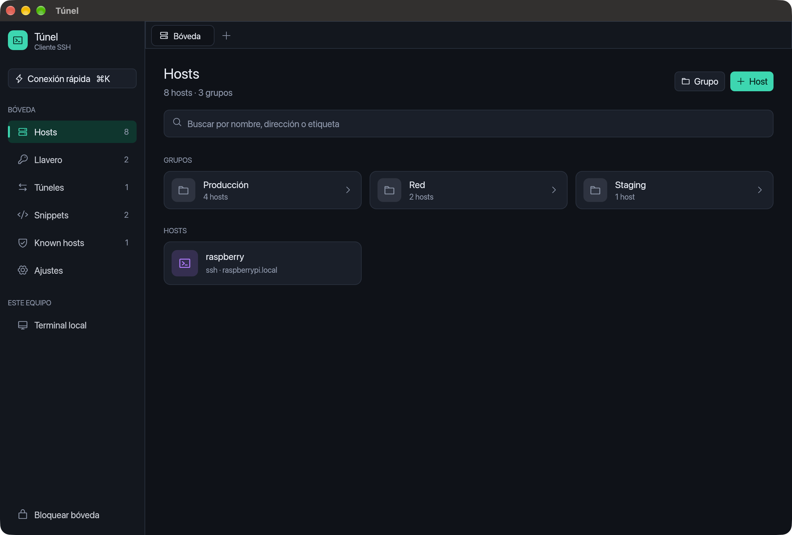

## Funciones

### Hosts y bóveda

- **Bóveda local cifrada** con contraseña maestra (Argon2id + XChaCha20-Poly1305). Nada sale del equipo.
  La contraseña maestra nueva tiene al menos 12 caracteres, con mayúsculas, minúsculas, números
  y algún carácter especial.
- **Touch ID y Windows Hello**: en **Ajustes → Seguridad** se activa el desbloqueo con la huella,
  la cara o el PIN de Windows Hello, solo en ese equipo. La primera vez de cada día se pide la
  contraseña maestra, para no olvidarla; al cambiarla hay que volver a activarlo.
- **Hosts y grupos anidados**: los hosts heredan usuario y puerto de su grupo. Etiquetas,
  filtro por etiquetas, búsqueda por nombre, dirección o etiqueta, y duplicar host. Cada grupo
  puede llevar cualquiera de los iconos de [Phosphor](https://phosphoricons.com) en lugar de la
  carpeta, y su tarjeta dice cuántos subgrupos y hosts tiene.
- **Llavero**: identidades (usuario + contraseña, clave o agente SSH) y claves privadas
  OpenSSH/PEM, cifradas o no, con certificados OpenSSH opcionales. Las contraseñas se ven
  con un ojo: las tuyas siempre; las de un Team, solo sus admins.
- **Claves SSH**: genera claves Ed25519, ECDSA o RSA de 4096 bits, con frase de paso
  opcional, e instálalas en un host como `ssh-copy-id`, sin duplicarlas. El llavero avisa
  de las claves RSA de menos de 3072 bits, de las DSA y de las claves de `~/.ssh` sin frase
  de paso.
- **Importar `~/.ssh/config`**: hosts, usuarios, puertos, `ProxyJump` y claves.
- **Importar de la nube**: máquinas de AWS EC2, Azure y DigitalOcean, con la sesión que ya
  tengas en `aws`, `az` o `doctl` (Túnel no guarda credenciales de la nube). Se elige cuenta
  (y región en AWS), se marcan las máquinas y entran como hosts en un grupo, por su IP pública
  o la privada. Volver a importar actualiza la IP de las que ya estaban y respeta lo demás.
- **Contenedores** (en «Este equipo»): los contenedores en marcha de `docker` y los pods de
  cada contexto de `kubectl`, con un botón para abrir una shell en una pestaña (bash si la
  imagen lo tiene; si no, sh). En un pod con varios contenedores se elige cuál. Usa tus
  herramientas y tu `~/.kube/config` tal cual, también con Docker Desktop en Windows.
- **Docker en tus servidores**: en el menú de un host SSH, **Contenedores Docker** lista los
  contenedores en marcha del servidor y abre una shell en ellos por la misma conexión
  (`docker exec -it` con terminal). Tu usuario debe poder usar Docker allí (grupo `docker`).
  En un host de un Team cuenta como una conexión: queda en el registro y, si el Team graba,
  se graba.
- **Conexión rápida** (`⌘K` / `Ctrl+K`): busca un host guardado o escribe
  `usuario@servidor:puerto` (también `ssh usuario@servidor -p 2222`) para conectar sin guardarlo.

<p>
  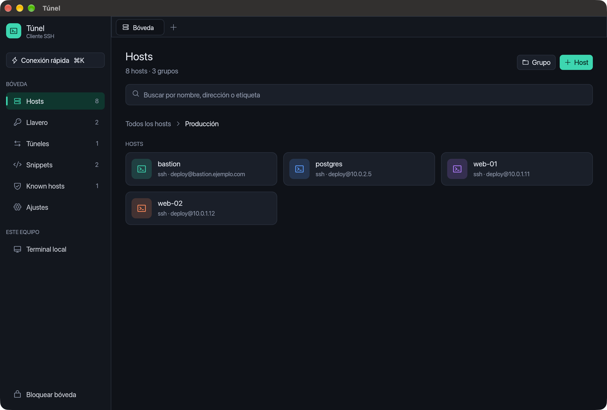
  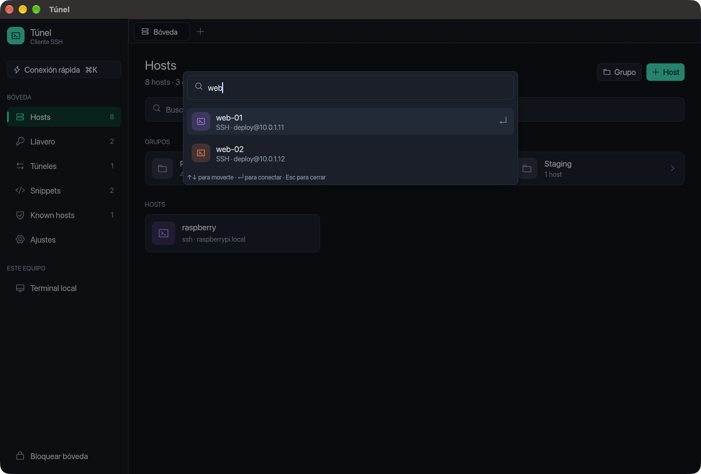
</p>

### Conexiones

- **SSH** con autenticación por clave, certificado, agente SSH (Unix y Windows), contraseña
  y keyboard-interactive (2FA).
- **Llaves de seguridad FIDO2** (claves `sk-ed25519` y `sk-ecdsa` de OpenSSH, como una YubiKey).
  En macOS y Linux, Túnel pide que toques la llave y, si la clave lo exige, el PIN. En Windows
  (10 versión 1903 o posterior) lo pide el propio sistema en su ventana de seguridad, sin
  permisos de administrador.
- **Verificación de la clave del servidor**: pide confirmación la primera vez y avisa en rojo
  si la clave cambia, aunque sea de otro algoritmo.
- **Jump hosts encadenados** (ProxyJump) y conexión a través de **proxy SOCKS5 o HTTP**.
- **Mosh** (usa el `mosh-client` del sistema), **Telnet** y **puerto serie**.
- **Terminal local** del sistema.
- **Reenvío X11**: las aplicaciones gráficas del servidor se abren en tu equipo. Hace falta un
  servidor X local (XQuartz en macOS, VcXsrv en Windows; en Linux ya viene con el escritorio).
  Al servidor se le envía una cookie falsa, como hace OpenSSH, y la real no sale de tu equipo.
  Úsalo solo con servidores de confianza.
- Reenvío del agente SSH, variables de entorno y snippet de inicio por host.

<p>
  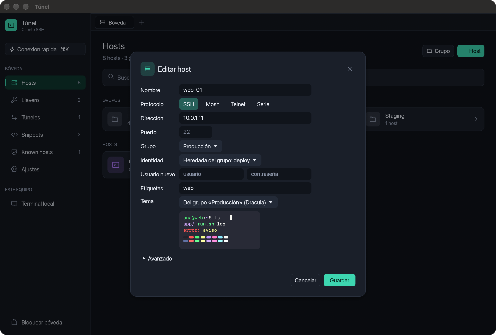
  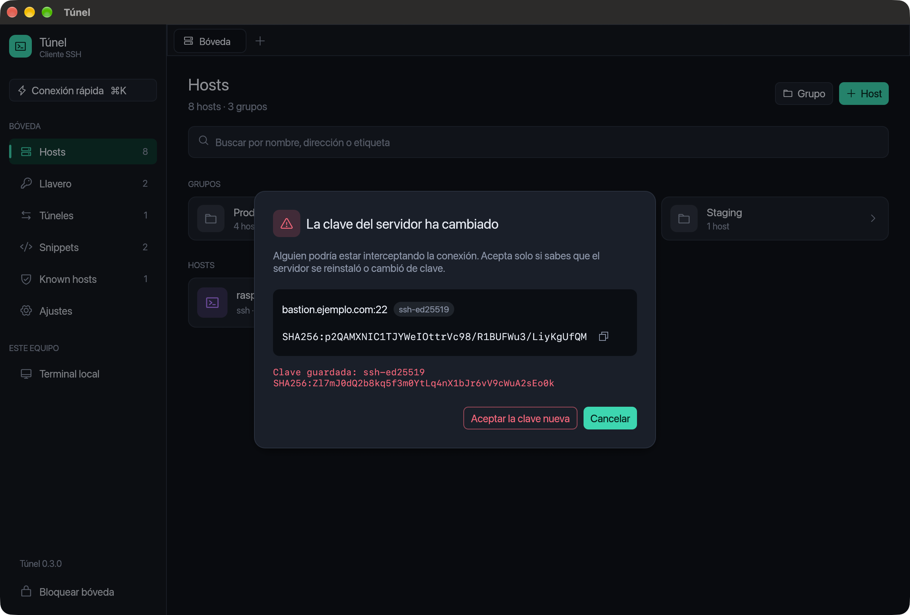
</p>

### Terminal

- Emulación basada en `alacritty_terminal`: 256 colores y truecolor, negrita, cursiva,
  subrayado, caracteres de doble ancho, historial desplazable y selección con copiar y pegar.
- Pestañas con indicador de estado y reconexión con un clic. Con clic derecho en una pestaña:
  reconectar, duplicar, compartir con un Team o cerrar, y también:
  - **Dividir a la derecha** o **Dividir abajo**: hasta cuatro terminales a la vista a la vez,
    de hosts distintos. La franja entre paneles se arrastra para repartir el espacio, y el
    panel en el que pulsas es el que recibe el teclado.
  - **Abrir en otra ventana**: la terminal pasa a una ventana propia, por ejemplo para llevarla
    a otra pantalla y compararla. Al cerrar esa ventana, la terminal vuelve a la principal sin
    desconectarse.
- Pegado seguro (bracketed paste), título de ventana por OSC y registro de la sesión en archivo.
- **13 temas incluidos**: Túnel Oscuro y Claro, Dracula, Nord, Tokyo Night, Catppuccin
  Mocha y Latte, One Dark, Gruvbox, Solarized Oscuro y Claro, Monokai y GitHub Claro.
- **Importa temas** de iTerm2 (`.itermcolors`) y Windows Terminal (`.json`).
- **Tema por host o por grupo**, por ejemplo uno distinto para producción. Los hosts sin tema
  propio usan el de su grupo y, si tampoco lo tiene, el general.
- Cursor en bloque, barra o subrayado. Los programas como vim pueden cambiarlo mientras se ejecutan.
- **Fuentes de Google Fonts** para la terminal (JetBrains Mono, Source Code Pro, Ubuntu Mono,
  Fira Code…) y para la interfaz (Open Sans, Inter, Roboto…), o cualquier otra familia de
  Google Fonts escribiendo su nombre. Se descargan la primera vez y quedan en la caché del
  equipo.

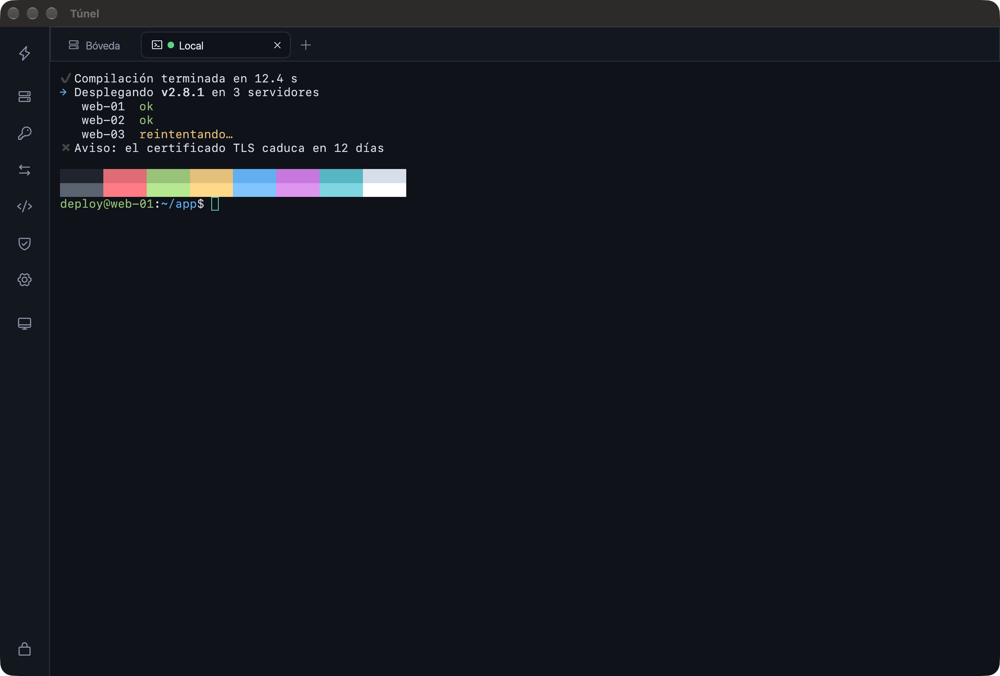

<p>
  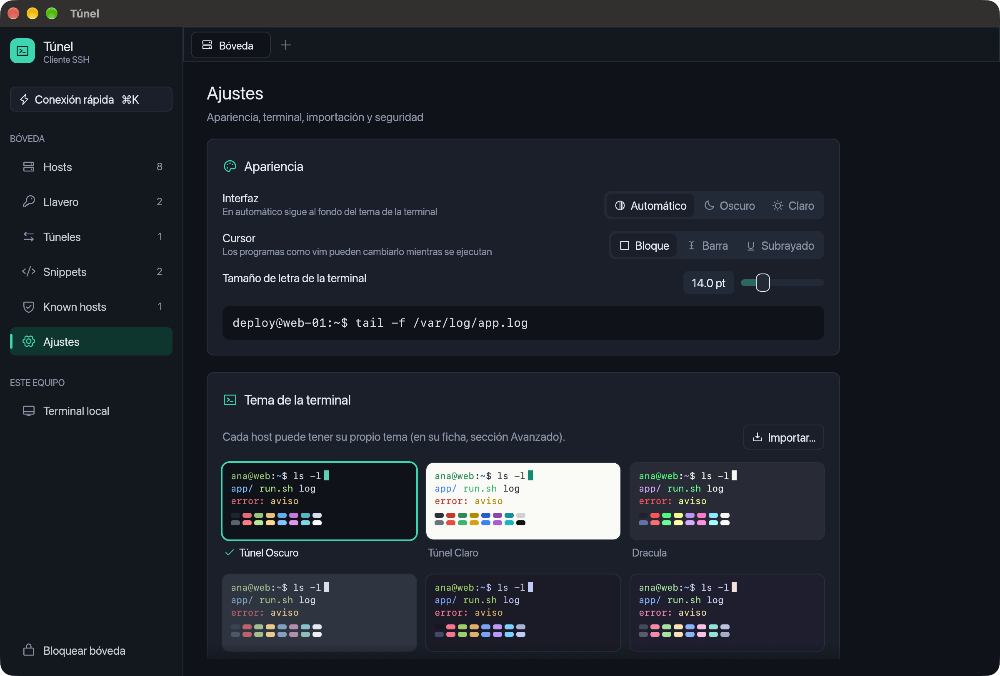
  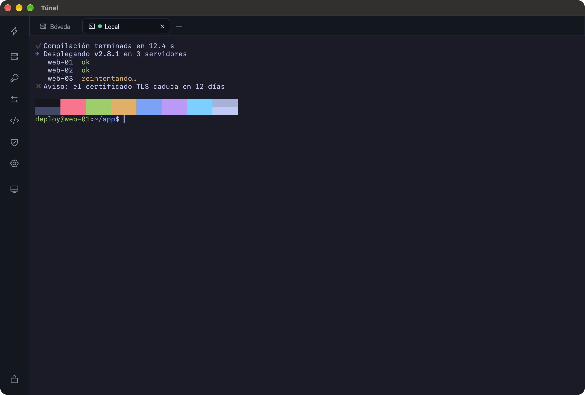
</p>

### Túneles, SFTP y snippets

- **Reenvío de puertos** local (`-L`), remoto (`-R`) y dinámico (`-D`, proxy SOCKS5), con aviso
  si una regla escucha fuera de `localhost`.
- **SFTP de doble panel**: navegar, subir, descargar, renombrar, borrar y crear carpetas.
- **Snippets**: comandos guardados que se envían a la terminal activa o a todas a la vez.
- **Autocompletado de comandos**: mientras escribes, Túnel sugiere en gris cómo seguir con lo
  que ya ejecutaste en ese host, tus snippets y lo ejecutado en otros hosts; **→** la acepta y
  **Tab** sigue siendo el de la shell. Solo cuenta lo que el servidor muestra en pantalla, así
  que una contraseña escrita sin eco no se guarda, y no interviene en vim, less o top. El
  historial va cifrado junto a la bóveda, solo en ese equipo; lo que empieza por un espacio no
  se recuerda, y en **Ajustes → Terminal** se desactiva o se borra. Viene activado. Ojo: también
  se recuerda lo que escribes en programas que repiten lo tecleado sin pantalla completa, como
  `mysql`, `psql`, `python` o un `ssh` a otro servidor, y las contraseñas que pases como
  argumento (`mysql -pclave`); empiézalos por un espacio si no quieres que se guarden.

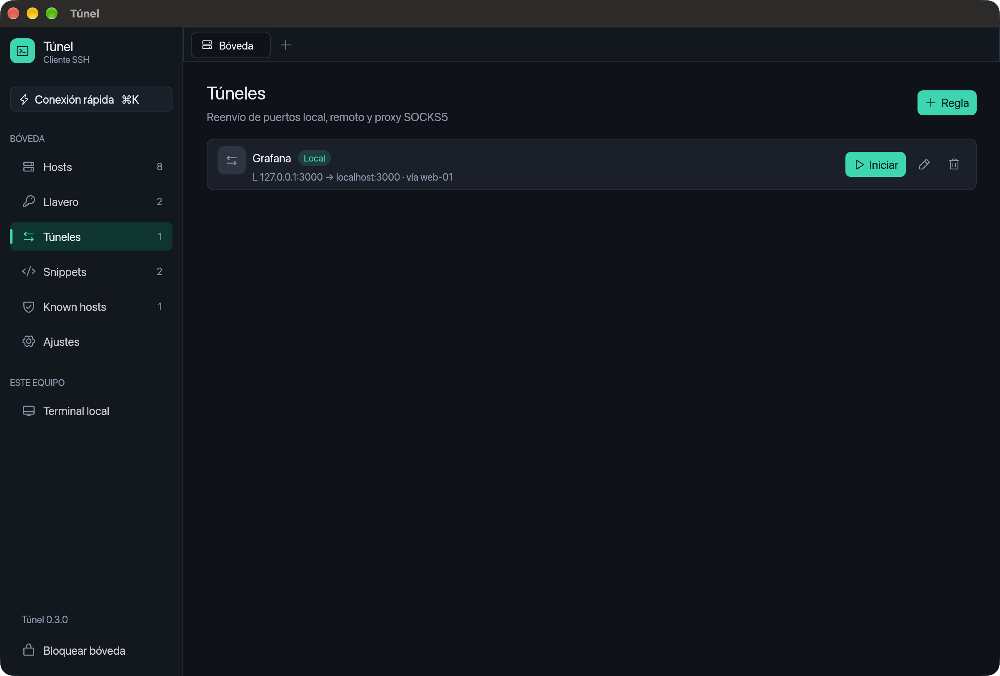

### Interfaz

- Interfaz oscura o clara; en modo automático sigue al fondo del tema de la terminal.
- Usa la fuente del sistema: SF y SF Mono en macOS, Segoe UI y Cascadia en Windows, Inter,
  Noto y JetBrains Mono en Linux si están instaladas.
- Mientras hay una sesión abierta, el menú lateral se reduce a iconos.

<p>
  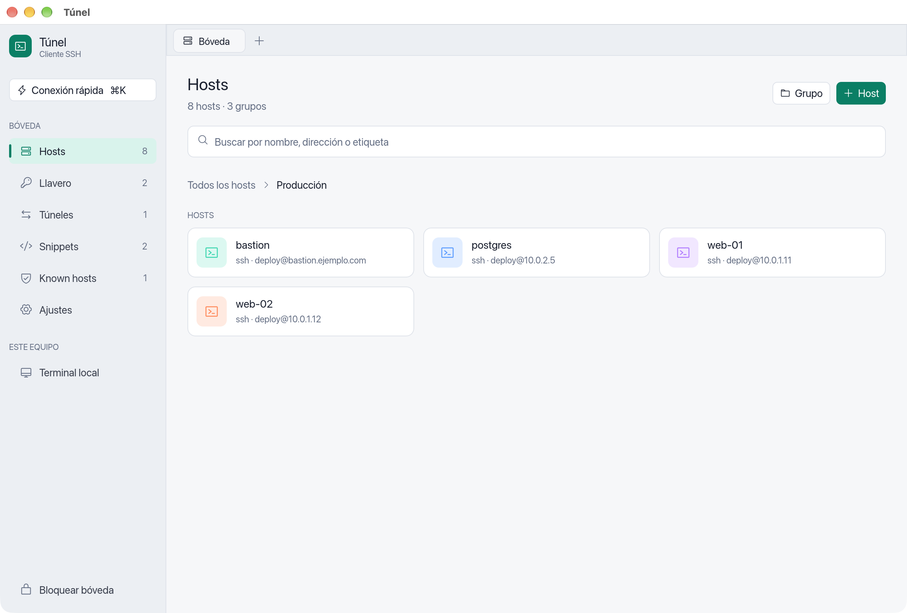
  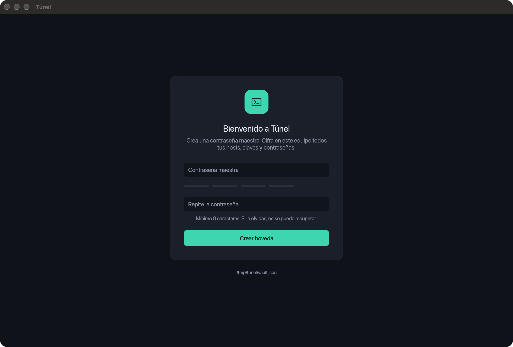
</p>

**Atajos:** `⌘K` / `Ctrl+K` conexión rápida · `⌘⇧T` / `Ctrl+Shift+T` terminal local ·
`⌘⇧W` / `Ctrl+Shift+W` cerrar pestaña.

## Instalación

Túnel muestra su versión al pie del menú lateral. Cada 12 horas pregunta a GitHub si hay
una versión nueva y, si la hay, avisa con un botón **Actualizar**. Un clic sobre la versión
vuelve a comprobarlo.

**Actualizar** descarga el instalador de tu sistema en la carpeta Descargas, comprueba que es
el publicado y lo abre; el resto lo haces tú, como la primera vez. La comprobación: el
SHA-256 del instalador tiene que estar en `SHA256SUMS.txt`, y esa lista tiene que llevar la
firma Ed25519 de quien publica Túnel, cuya clave pública va dentro de la app. Sin la clave
privada nadie puede colar un instalador, aunque controle la descarga. Si la versión no trae
la lista firmada, o algo no cuadra, el botón abre la descarga en el navegador.

### macOS

Descarga `tunel_<versión>_universal.dmg` desde [Releases](https://github.com/puentescamilo/Tunel/releases).
Funciona en Macs con Apple Silicon e Intel, con macOS 11 o posterior. Abre el `.dmg` y
arrastra **Túnel** a **Aplicaciones**.

La app está firmada de forma local (ad hoc) pero no notarizada por Apple, así que la primera
vez macOS la bloquea. Para abrirla:

1. Intenta abrir Túnel y cierra el aviso.
2. Ve a **Ajustes del Sistema → Privacidad y seguridad** y pulsa **Abrir igualmente** junto al
   mensaje sobre Túnel.

También puedes quitar la marca de cuarentena desde la terminal:

```bash
xattr -dr com.apple.quarantine /Applications/Túnel.app
```

Para Mosh hace falta `mosh` instalado en tu equipo y en el servidor.

### Linux

Descarga `tunel_<versión>_amd64.deb` desde [Releases](https://github.com/puentescamilo/Tunel/releases)
e instálalo con:

```bash
sudo apt install ./tunel_0.13.1_amd64.deb
```

Funciona en Ubuntu 22.04, Debian 12 o posteriores, en equipos x86_64. Para elegir archivos
(importar claves o temas) se usa el portal del escritorio (`xdg-desktop-portal`), que ya viene
en GNOME y KDE.

### Windows

Descarga uno de los dos instaladores desde [Releases](https://github.com/puentescamilo/Tunel/releases).
Ambos son para Windows 10 y 11 de 64 bits:

- `tunel_<versión>_x64-setup.exe`: se instala solo para tu usuario y no pide permisos de administrador.
- `tunel_<versión>_x64_es-ES.msi`: se instala para todo el equipo; es el indicado para
  distribuirlo en una empresa.

Los instaladores no están firmados, así que Windows SmartScreen avisa la primera vez. Pulsa
**Más información → Ejecutar de todas formas**. Túnel funciona también en equipos y máquinas
virtuales sin tarjeta gráfica: en ese caso dibuja por software.

### Desde el código

Hace falta [Rust](https://rustup.rs/) 1.89 o superior.

```bash
git clone https://github.com/puentescamilo/Tunel.git
cd Tunel
cargo run --release -p tunel-app
```

En Linux se necesitan además un compilador de C y `libudev` para el puerto serie:

```bash
sudo apt install build-essential pkg-config libudev-dev
```

La bóveda se guarda en el directorio de datos del usuario; en macOS es
`~/Library/Application Support/dev.tunel.tunel/vault.json`. Para usar otra ruta:

```bash
TUNEL_VAULT=/ruta/vault.json cargo run --release -p tunel-app
```

### Generar el `.dmg`

```bash
rustup target add aarch64-apple-darwin x86_64-apple-darwin
cargo install cargo-packager --locked
./scripts/package-macos.sh
```

El script compila para Apple Silicon e Intel, une ambos en un binario universal, lo empaqueta
con [cargo-packager](https://github.com/crabnebula-dev/cargo-packager), comprueba dentro del
`.dmg` que el ejecutable es universal y deja el resultado y su `SHA256SUMS.txt` en `dist/`.
El icono se regenera con `swift crates/tunel-app/assets/icons/generar-icono.swift icon-1024.png`.

### Generar el `.deb`

Compílalo en Ubuntu 22.04, con las dependencias de «Desde el código»: un paquete hecho en una
distribución más nueva no funciona en las anteriores.

```bash
cargo install cargo-packager --locked
cargo build --release --locked -p tunel-app
cargo packager --release -p tunel-app --formats deb
```

### Generar los instaladores de Windows

Hacen falta las Build Tools de Visual Studio 2022 con el compilador de C++. La librería de
criptografía necesita NASM, salvo que uses los objetos ya compilados que trae:

```powershell
cargo install cargo-packager --locked
$env:AWS_LC_SYS_PREBUILT_NASM = "1"
cargo build --release --locked -p tunel-app
cargo packager --release -p tunel-app --formats wix,nsis
```

cargo-packager descarga WiX y NSIS la primera vez y deja el `.msi` y el `.exe` en `dist/`.

### Firmar la versión

Con los cuatro paquetes en `dist/`, en el equipo que tiene la clave privada:

```bash
./scripts/firmar-version.sh 0.13.1
```

Escribe `SHA256SUMS.txt` con los cuatro, lo firma con `ssh-keygen -Y sign` en
`SHA256SUMS.txt.sig` y comprueba la firma con la clave pública que lleva la app. Los dos
archivos se suben a la versión junto a los paquetes. La clave privada se lee de
`~/.config/tunel-publicacion/firma_ed25519` o de `$TUNEL_CLAVE_FIRMA`; si se pierde, las apps
ya instaladas no aceptarán más actualizaciones automáticas y habrá que instalar a mano la
versión que traiga una clave nueva.

## Sincronización entre equipos

Túnel sincroniza la bóveda entre tus equipos a través de tu propio servidor, `tunel-server`.
Más abajo se explica cómo montarlo. La bóveda local sigue siendo la principal:

- **Sin conexión:** funciona igual. Los cambios esperan en una cola cifrada hasta que el
  servidor responde.
- **Conflictos:** si editas lo mismo en dos equipos, gana la última edición.
- **Qué se sincroniza:** hosts, grupos, identidades, claves, snippets, túneles y claves de
  host conocidas. Los ajustes (fuente, tema general, cursor) son de cada equipo.
- **Cómo se entra:** con correo y contraseña de la cuenta o, si el servidor lo tiene
  configurado, con la cuenta de Google o Microsoft 365 de tu organización (ver
  [Iniciar sesión con Google o Microsoft 365](#5-iniciar-sesión-con-google-o-microsoft-365-opcional)).

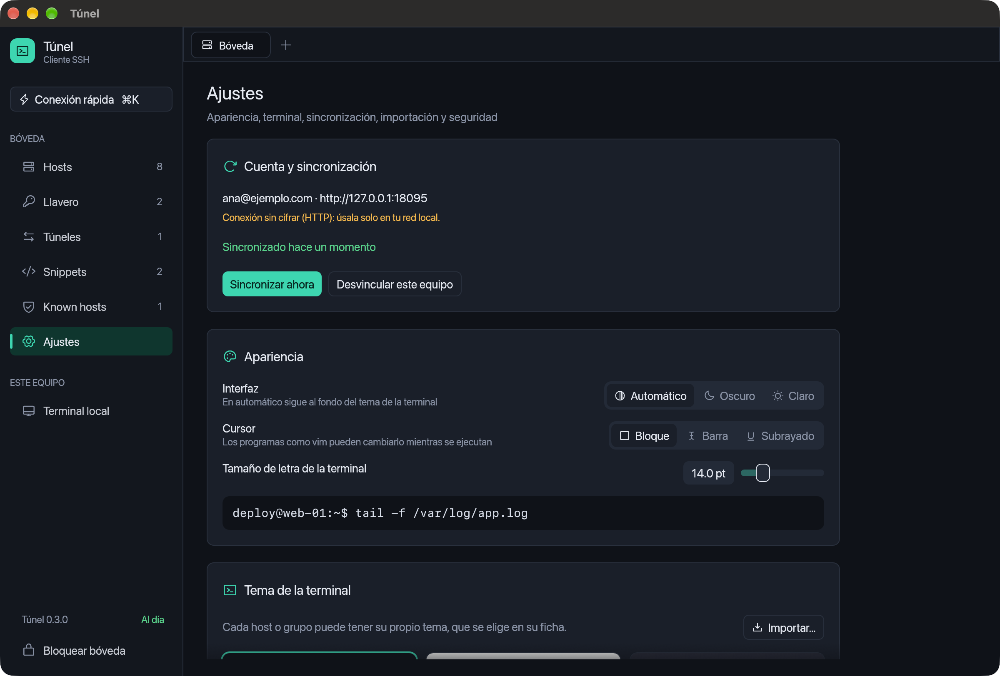

En **Ajustes → Cuenta y sincronización**, escribe la dirección del servidor, tu correo y una
contraseña para la cuenta (de al menos 12 caracteres):

- **Crear cuenta**, en el primer equipo.
- **Iniciar sesión**, en los demás. Lo que ya tuvieras en ese equipo se combina con la bóveda
  de la cuenta.

Los cambios se suben unos segundos después de hacerlos y cada equipo descarga lo nuevo cada
5 minutos, o al pulsar **Sincronizar ahora**.

La contraseña de la cuenta no sale del equipo: de ella se derivan una clave para cifrar y otra
para identificarse ante el servidor. Si la olvidas, los datos de la cuenta no se pueden
recuperar, pero la bóveda local de cada equipo sigue intacta.

## Teams: compartir hosts con otras personas

Un **Team** comparte hosts y grupos, con sus credenciales, entre varias cuentas del mismo
servidor. Va cifrado de extremo a extremo como el resto: el servidor sabe quién es miembro de
cada Team, pero no su nombre ni lo que contiene. Cada persona necesita su propia cuenta
(ver [Crear la cuenta](#4-crear-la-cuenta) para abrir el registro).

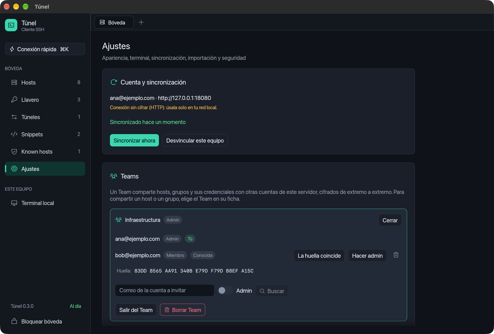

1. En **Ajustes → Teams**, escribe un nombre y pulsa **Crear Team**.
2. Pulsa **Miembros**, escribe el correo de la otra cuenta y **Buscar**. Compara con esa
   persona la **huella** que aparece (en persona o por teléfono) y, si coincide, **invita**.
3. La otra persona ve la invitación en sus Ajustes, con tu huella. Si coincide, la acepta.

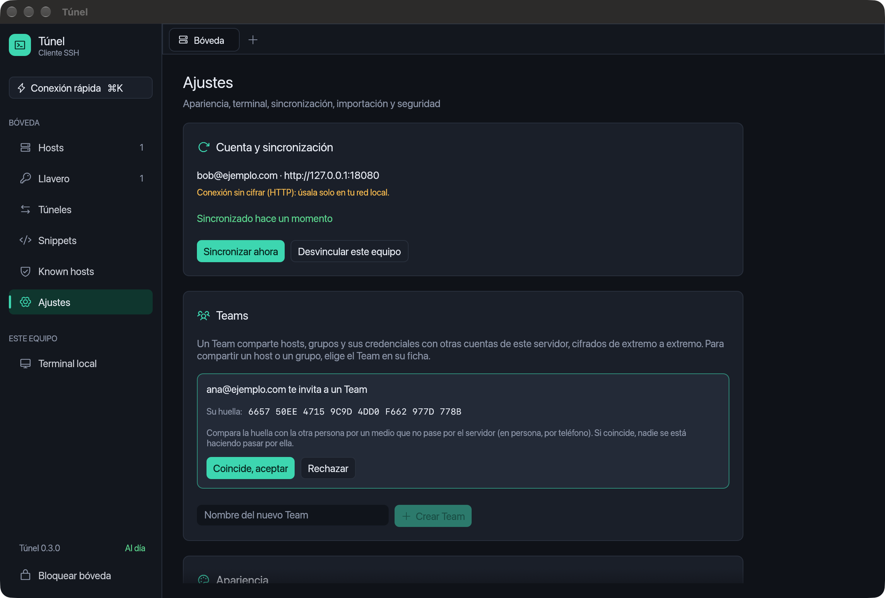

Para compartir algo, abre la ficha de un host o de un grupo y elige el Team en **Compartir
en**. Un grupo se comparte con sus subgrupos y sus hosts. Si su identidad es personal,
eliges entre llevar una copia al Team (la original no cambia) o dejarlo sin credenciales para
que cada cual ponga las suyas. Los hosts compartidos muestran el nombre del Team.

- **Roles:** los admins invitan, cambian roles, expulsan y borran el Team; los miembros usan
  y editan lo compartido.
- **Expulsar** a alguien renueva la clave del Team: deja de recibir lo que se guarde después.
  Si alguien sale por su cuenta, la clave la renueva el primer admin que sincroniza.
- **Suplantación:** Túnel recuerda la clave de cada persona la primera vez que confirmas su
  huella. Si el servidor entrega otra, el Team se detiene y lo avisa: compara la huella de
  nuevo antes de aceptarla.
- **Lista de miembros:** los admins guardan junto al Team la lista de miembros, cifrada con
  su clave y firmada por el admin que la escribe: ni el servidor ni un miembro la pueden
  cambiar. Una clave nueva del Team solo se acepta si la envolvió un admin de esa lista, y
  al renovarla solo llega a quien está en ella: el servidor no puede volver a meter a alguien
  que se sacó. Si avisa de que alguien no está en la lista y debe estar, sácalo y vuelve a
  invitarlo. Los Teams anteriores a Túnel 0.7.1 la estrenan al invitar o al renovar la clave.
- Lo de un Team solo usa lo de ese mismo Team: un host compartido no puede apuntar a tu
  identidad, grupo, jump host o snippet personal, ni un túnel compartido ir por un host tuyo.
- Las claves de host conocidas no se comparten: cada persona decide de qué servidores se fía.

### Registro de actividad

Los admins ven en la ficha del Team, en **Ajustes → Teams**, quién hizo qué y cuándo:

- quién se conectó a un host del Team (terminal, SFTP o túnel);
- quién vio la contraseña de una identidad del Team o cambió una contraseña o clave privada;
- a quién invitaron, quién entró o salió, a quién sacaron y quién cambió un rol.

Cada entrada la firma con su clave quien hizo la acción y va cifrada con la clave del Team:
el servidor la guarda pero no puede leerla ni inventarla, y un miembro no puede escribir en
nombre de otro. Una entrada con la firma de otra persona aparece marcada. Al renovar la
clave del Team, la anterior queda guardada con la nueva, así se sigue leyendo lo de antes.

Lo escribe la app de cada persona: sin conexión, las entradas esperan y se suben al
sincronizar. Avisa también de una entrada que solo puede hacer un admin firmada por quien no
lo es, y de una cuya fecha no cuadra con su llegada al servidor.

- El servidor guarda hasta 10.000 entradas de cada cuenta en cada Team. Para hacer sitio
  solo borra las de esa misma cuenta con más de 90 días; si no puede, rechaza las nuevas.
  Así nadie puede llenar el registro para borrar lo que hicieron los demás ni lo suyo
  reciente.
- El servidor sí podría borrar entradas o no entregarlas.
- Que solo lo lean los admins lo decide el servidor: cualquier miembro tiene la clave del
  Team, así que con la base de datos del servidor podría descifrarlo.
- Hace falta `tunel-server` 0.9.0 o posterior; con uno anterior las entradas esperan en la
  cola de cada equipo (como mucho 1.000).

### Grabación de sesiones

Un admin puede activar **Grabar** en la ficha del Team (**Ajustes → Teams**). Desde entonces,
cada terminal que alguien abre con un host del Team se graba, con un aviso visible en la propia
terminal. Se graba lo que muestra la terminal y sus cambios de tamaño, **nunca lo que se
teclea**. Ojo: lo que el host repite en pantalla sí queda grabado, como una contraseña escrita
en un programa que la muestra o un archivo con secretos que se imprime. SFTP y los túneles no
se graban.

Los admins ven las grabaciones en la misma ficha: quién, cuándo, cuánto duró y si terminó.

- **Ver:** se reproduce en una pestaña de solo lectura, con pausa, velocidad (×1 a ×8) y
  salto al final. Las pausas de más de dos segundos se acortan.
- **Guardar** como `.cast`: el formato de [asciinema](https://asciinema.org), para verla con
  `asciinema play` o compartirla. Lleva tal cual las secuencias de control de la sesión: al
  reproducirlo en otra terminal, esa terminal las obedece (título, portapapeles…). En Túnel
  no: la reproducción las ignora.
- **Borrar.**

Seguridad:

- La grabación se sube por trozos mientras dura la sesión. Cada trozo lo firma quien se
  conectó y va cifrado con la clave del Team, encadenado al anterior. El servidor no puede
  leerla, ni cambiar, quitar o reordenar trozos sin que la reproducción lo avise. Sí puede
  quedarse sin los últimos: la grabación aparece entonces como sin terminar.
- Que se grabe lo dice la lista de miembros firmada por los admins: ni el servidor ni un
  miembro lo pueden apagar.
- Lo hace la app de cada persona: una app modificada podría no grabar. Sin conexión, lo
  grabado espera en memoria (hasta 32 MiB) y se sube al volver.
- El servidor guarda como mucho 64 MiB por grabación y `TUNEL_GRABACIONES_GB` por Team, y las
  borra a los `TUNEL_GRABACIONES_DIAS`. Ninguna cuenta puede ocupar más de la mitad de ese
  espacio ni pasar de 1.000 grabaciones por Team: así nadie lo llena para que no se grabe a
  los demás. Al llenarse, las sesiones dejan de grabarse con un aviso y el aviso de la
  terminal desaparece; un admin puede borrar grabaciones viejas.
- Si se renueva la clave del Team con una sesión abierta, lo que sigue se graba con la clave
  nueva en cuanto este equipo la recibe: quien salió no puede leerlo.
- Hace falta `tunel-server` 0.9.0. Todos los admins deben usar Túnel 0.9.0: uno anterior que
  cambie la lista de miembros desactivaría la grabación sin darse cuenta.

### Sesiones compartidas

Puedes dejar que los miembros de un Team vean en vivo una terminal abierta y darle el control
a alguno, por ejemplo para resolver juntos una incidencia. Haz clic derecho en la pestaña y
elige **Compartir con** y el Team. Quien comparte ve encima de la terminal quién está mirando
y, a cada persona, le da o le quita el control, o la saca de la sesión.

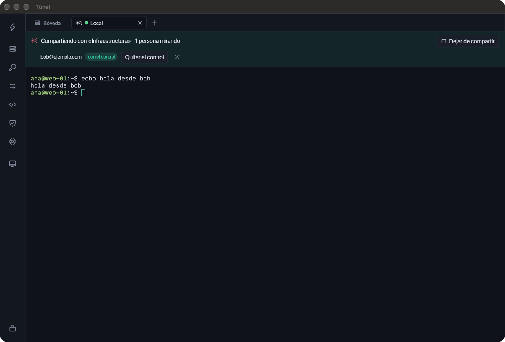

Los demás miembros ven la sesión en **Hosts → En vivo** y pulsan **Mirar**. Se abre en una
pestaña de solo lectura con el tamaño de la terminal de quien comparte; con **Pedir el
control** pueden pedir permiso para escribir.

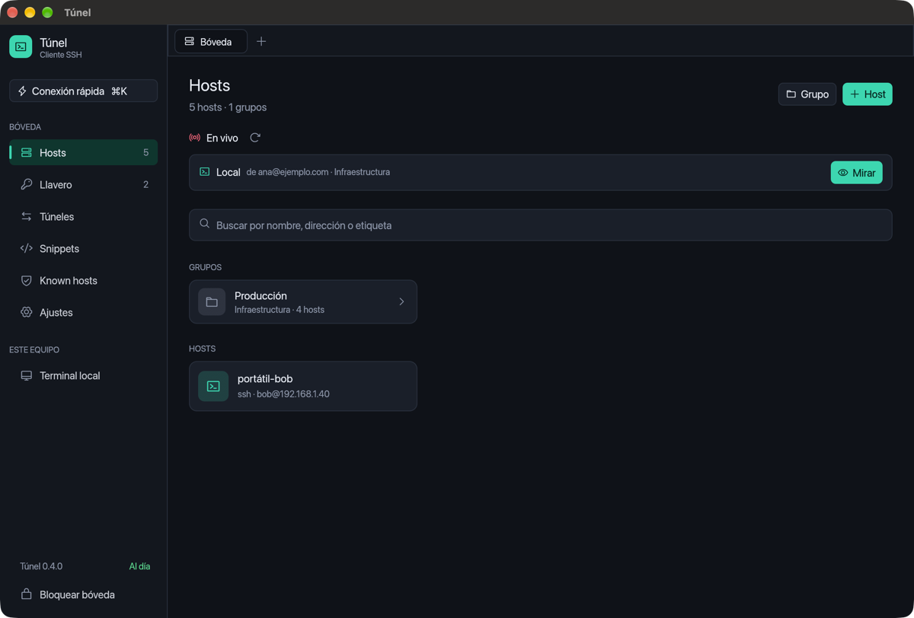

- **Cifrado de extremo a extremo:** el servidor reenvía la sesión sin poder leerla ni
  cambiarla. Detecta además si quita, repite o reordena algo, y si a quien llega le da una
  pantalla antigua.
- **Control:** solo escribe quien tiene el control, con una clave propia que quien comparte
  le envuelve. Para darlo hace falta haber confirmado la huella de esa persona; si no, Túnel
  la muestra para compararla antes.
- **Suplantación:** la sesión muestra si la clave de quien comparte es la que ya conocías. Si
  no la has confirmado, avisa antes de que escribas nada; si cambió, no deja mirarla.
- La sesión termina al cerrar la pestaña o pulsar **Dejar de compartir**. Quien sale del Team
  deja de verla al momento, y si cambia la clave del Team la terminal deja de compartirse:
  vuelve a compartirla si quieres.
- Con nginx delante del servidor, hace falta la configuración de WebSocket de
  [Arrancarlo](#2-arrancarlo).

## Montar el servidor de sincronización con Docker

`tunel-server` guarda las bóvedas cifradas de extremo a extremo: solo recibe datos cifrados
con identificadores opacos, nunca tu contraseña. Quien administre el servidor no puede leer
hosts, contraseñas ni claves. Es un único binario con una base de datos SQLite.

### Lo que necesitas

- Un equipo o máquina virtual con **Docker** y **Docker Compose 2.24 o posterior**
  (`docker compose version`). Con 512 MiB de RAM es suficiente. Sirve tanto x86_64 como ARM.
- Para usarlo fuera de tu red: un **dominio** que apunte a la IP pública del servidor y los
  puertos **80 y 443** abiertos hacia él (para el certificado de Let's Encrypt).

### 1. Descargar el código

La imagen se compila en el propio servidor, así que sirve para su arquitectura:

```bash
git clone https://github.com/puentescamilo/Tunel.git
cd Tunel
```

### 2. Arrancarlo

Elige una de estas tres formas. Todos los comandos se ejecutan desde la raíz del repositorio.
La primera vez tarda unos minutos en compilar.

**A. Con dominio y HTTPS automático (recomendada).** Caddy obtiene y renueva el certificado,
redirige HTTP a HTTPS y es lo único que queda expuesto:

```bash
echo "TUNEL_DOMINIO=tunel.tudominio.com" > crates/tunel-server/.env

docker compose -f crates/tunel-server/compose.yaml \
  -f crates/tunel-server/compose.https.yaml up -d --build
```

En Túnel, el servidor es `https://tunel.tudominio.com`.

**B. Detrás de un proxy que ya tienes** (nginx, Traefik, Caddy). El servidor escucha solo en
`127.0.0.1:8080`; apunta allí tu proxy. Si el 8080 ya está ocupado, elige otro con
`TUNEL_PUERTO` en el `.env` (ver [Configuración](#configuración)):

```bash
cp crates/tunel-server/.env.example crates/tunel-server/.env   # y edítalo si hace falta
docker compose -f crates/tunel-server/compose.yaml up -d --build
```

Con nginx, por ejemplo. Las sesiones compartidas usan WebSocket: sin las cabeceras `Upgrade`
y `Connection`, todo lo demás funciona pero no se puede compartir ni mirar una terminal.

```nginx
map $http_upgrade $connection_upgrade {
    default upgrade;
    ''      close;
}

server {
    listen 443 ssl;
    server_name tunel.tudominio.com;
    # ssl_certificate y ssl_certificate_key de tu certificado
    # Al renovar la clave de un Team se sube todo su contenido de una vez.
    client_max_body_size 48m;
    location / {
        proxy_pass http://127.0.0.1:8080;
        proxy_http_version 1.1;
        proxy_set_header Upgrade $http_upgrade;
        proxy_set_header Connection $connection_upgrade;
    }
}
```

**C. Solo en tu red local, para probar.** En `crates/tunel-server/.env`, pon `TUNEL_IP=0.0.0.0`
y arranca como en la opción B. En Túnel, el servidor
es `http://<IP-del-servidor>:8080`. Túnel solo acepta HTTP con direcciones de red local y avisa
de que la conexión no va cifrada; el contenido sigue cifrado de extremo a extremo, pero no lo
expongas así a Internet.

### 3. Comprobar que funciona

```bash
docker compose -f crates/tunel-server/compose.yaml ps   # debe decir (healthy)
curl https://tunel.tudominio.com/health                  # responde: ok
```

En la opción B o C, usa `curl http://127.0.0.1:8080/health` en el propio servidor (con el puerto
de `TUNEL_PUERTO` si lo cambiaste).

### 4. Crear la cuenta

En el primer equipo, abre **Ajustes → Cuenta y sincronización**, escribe la dirección del
servidor, tu correo y la contraseña de la cuenta, y pulsa **Crear cuenta**. En los demás
equipos, usa los mismos datos con **Iniciar sesión**.

El servidor solo deja crear **la primera cuenta**, para que nadie más pueda usarlo. Para
admitir más (por ejemplo, una por persona o para los [Teams](#teams-compartir-hosts-con-otras-personas)),
pon una de estas opciones en `crates/tunel-server/.env` (cópialo de `.env.example` si aún no
lo tienes) y vuelve a ejecutar el comando de arranque:

```bash
# Solo correos de estos dominios, separados por comas. Cada persona crea su cuenta.
TUNEL_DOMINIOS_PERMITIDOS=gammaingenieros.com,otra-empresa.com

# O cualquier correo. Ábrelo solo mientras creas las cuentas y luego bórralo.
TUNEL_REGISTRO_ABIERTO=1
```

Con `TUNEL_DOMINIOS_PERMITIDOS`, el registro queda abierto solo para esos dominios, exactos
(`gammaingenieros.com` no incluye `dev.gammaingenieros.com`). Las cuentas que ya existían
siguen funcionando aunque su correo sea de otro dominio. El servidor muestra al arrancar qué
registro tiene: `docker compose -f crates/tunel-server/compose.yaml logs tunel-server`.

### 5. Iniciar sesión con Google o Microsoft 365 (opcional)

Con un proveedor de identidad (Túnel 0.6.0 o posterior), cada persona entra con su correo
corporativo y no tiene una contraseña de cuenta que recordar. El proveedor solo confirma quién es: la sincronización se
cifra con la contraseña maestra de Túnel, así que el servidor sigue sin poder leer nada. Sin
ningún proveedor configurado, las cuentas se crean con correo y contraseña, como siempre, y
las dos formas conviven en el mismo servidor.

1. Registra una aplicación web en el proveedor con esta dirección de retorno (URI de
   redirección), cambiando el dominio y el proveedor:
   `https://tunel.tudominio.com/v1/auth/google/callback` (o `/microsoft/` u `/oidc/`).
   - **Google:** Google Cloud Console → APIs y servicios → Credenciales → Crear ID de cliente
     de OAuth → Aplicación web.
   - **Microsoft 365:** Microsoft Entra → Registros de aplicaciones → Nuevo registro → Web.
     Crea un secreto en «Certificados y secretos» y copia el «Id. de directorio (inquilino)».
     En «Configuración de token» → «Agregar notificación opcional» → Id., añade `email` y
     `xms_edov`: con ellas Microsoft confirma que el correo es de un dominio de tu
     organización, y sin ellas no se puede entrar.
   - **Otro proveedor OpenID Connect** (Keycloak, Authentik, Okta…): un cliente confidencial
     con esa dirección de retorno.
2. Pon en `crates/tunel-server/.env` la dirección pública, el ID y el secreto del cliente:

   ```bash
   TUNEL_URL_PUBLICA=https://tunel.tudominio.com
   TUNEL_DOMINIOS_PERMITIDOS=tuempresa.com

   TUNEL_GOOGLE_ID_CLIENTE=1234567890-abc.apps.googleusercontent.com
   TUNEL_GOOGLE_SECRETO=GOCSPX-...

   TUNEL_MICROSOFT_ID_CLIENTE=00000000-0000-0000-0000-000000000000
   TUNEL_MICROSOFT_SECRETO=...
   TUNEL_MICROSOFT_INQUILINO=11111111-1111-1111-1111-111111111111
   ```

3. Vuelve a ejecutar el comando de arranque. El registro del servidor muestra los proveedores y
   la dirección de retorno de cada uno.
4. En Túnel, **Ajustes → Cuenta y sincronización**: escribe la dirección del servidor y pulsa
   **Entrar con Google** (o con Microsoft 365). Termina en el navegador y vuelve a Túnel, que te
   pide tu **contraseña maestra**: con ella se cifra la sincronización. Tiene que ser la misma
   en todos tus equipos y cumplir las reglas de la contraseña maestra (al menos 12 caracteres,
   con mayúsculas, minúsculas, números y algún carácter especial); si la tuya no las cumple,
   cámbiala antes en **Ajustes → Seguridad**.

Si cambias la contraseña maestra, Túnel vuelve a cifrar la clave de la cuenta en el servidor:
en tus otros equipos tendrás que usar la nueva al volver a iniciar sesión. Cuando la sesión
caduca (a los 30 días), Ajustes muestra **Iniciar sesión con Google** para renovarla.

Para que **todas** las personas entren con el proveedor, añade `TUNEL_SOLO_PROVEEDORES=1` al
`.env`. Túnel oculta entonces el correo y la contraseña en Ajustes (desde la 0.6.2), y el
servidor rechaza crear o abrir cuentas con contraseña. Las cuentas con contraseña que ya
existían ya no pueden sincronizar, pero sí pasarse al proveedor sin perder nada, como se explica
más abajo.

- **Quién puede crear cuenta:** con Google o un emisor genérico hace falta
  `TUNEL_DOMINIOS_PERMITIDOS`; si no, cualquiera con una cuenta de Google podría crear una.
  Con Microsoft 365, el inquilino ya limita las cuentas a tu organización, y no se admiten
  `common`, `organizations` ni `consumers`.
- **Correos verificados:** solo se aceptan correos que el proveedor da por verificados.
- **La cuenta es de la persona, no del correo:** queda ligada al identificador de la persona
  en su proveedor. Si su correo cambia sigue siendo suya, y si el correo pasa a otra persona
  (o lo afirma otro proveedor) esa persona no entra en ella.
- **Cuentas con contraseña:** un correo que ya tiene cuenta con contraseña sigue entrando con
  ella; el proveedor no la sustituye solo. Para pasarla a un proveedor (Túnel 0.7.0 o
  posterior), en un equipo unido a ella abre **Ajustes → Cuenta y sincronización** y pulsa
  **Pasar mi cuenta a Google** (o al proveedor que sea). Hay que iniciar sesión con el
  proveedor y escribir la contraseña maestra. Se conservan los datos, los Teams y el par de
  claves; la contraseña de la cuenta deja de servir y se cierran sus sesiones, así que en
  los demás equipos hay que desvincular y volver a entrar con el proveedor. Funciona también
  con `TUNEL_SOLO_PROVEEDORES=1`.

### Administrar las cuentas

Con el servidor en marcha (Túnel 0.7.0 o posterior):

```bash
# Lista las cuentas: correo, forma de entrar, alta, Teams, registros y sesiones abiertas
docker compose -f crates/tunel-server/compose.yaml exec tunel-server tunel-server cuentas

# Cierra todas las sesiones de una cuenta: sus equipos tendrán que volver a iniciar sesión
docker compose -f crates/tunel-server/compose.yaml exec tunel-server \
  tunel-server cerrar-sesiones ana@tuempresa.com

# Borra una cuenta. Sin --confirmar solo muestra lo que pasaría
docker compose -f crates/tunel-server/compose.yaml exec tunel-server \
  tunel-server borrar-cuenta ana@tuempresa.com --confirmar
```

Al borrar una cuenta se borran sus registros y sesiones, y sale de sus Teams:

- Los Teams donde no quedaba nadie más se borran.
- Si era la única admin de un Team con más miembros, indica quién pasa a serlo con
  `--nuevo-admin <correo>`; si no, el comando se niega y no cambia nada.
- Los Teams de los que sale quedan pendientes de renovar la clave, como cuando se saca a
  alguien desde la app: su admin lo hace solo al sincronizar.
- Los demás miembros siguen abriendo la clave del Team que ella les envolvió, porque el
  servidor conserva su clave pública hasta que el Team renueva la clave. Después la borra.

### Mantenimiento

En estos comandos, añade `-f crates/tunel-server/compose.https.yaml` después del primer `-f`
si usas la opción A.

- **Actualizar** a una versión nueva: `git pull` y el mismo comando de arranque. Los datos se
  conservan en el volumen `tunel-server_tunel-datos`.
- **Ver los registros:** `docker compose -f crates/tunel-server/compose.yaml logs -f tunel-server`.
- **Copia de seguridad:** para el servidor, copia la base de datos del volumen y vuelve a
  arrancarlo. Deja `tunel.db` en la carpeta actual:

  ```bash
  docker compose -f crates/tunel-server/compose.yaml stop tunel-server
  docker run --rm -v tunel-server_tunel-datos:/datos:ro -v "$PWD":/copia \
    debian:bookworm-slim cp /datos/tunel.db /copia/
  docker compose -f crates/tunel-server/compose.yaml start tunel-server
  ```

  El contenido de la copia está cifrado, pero incluye los datos de inicio de sesión de las
  cuentas: guárdala en un sitio seguro.
- **Restaurar una copia:** con el servidor parado, copia `tunel.db` de vuelta al volumen:

  ```bash
  docker compose -f crates/tunel-server/compose.yaml stop tunel-server
  docker run --rm -v tunel-server_tunel-datos:/datos -v "$PWD":/copia:ro \
    debian:bookworm-slim sh -c "cp /copia/tunel.db /datos/tunel.db && chown 10001 /datos/tunel.db"
  docker compose -f crates/tunel-server/compose.yaml start tunel-server
  ```

  Después, pulsa **Sincronizar ahora** en cada equipo. Si la copia es anterior a la última
  sincronización, Túnel avisará de que el servidor devuelve datos antiguos: es la protección
  contra un servidor que retrocede. En ese caso, desvincula el equipo y vuelve a iniciar
  sesión; su bóveda local se combinará con la de la copia.

### Configuración

| Variable | Para qué sirve | Valor en Docker |
|---|---|---|
| `TUNEL_DOMINIO` | Dominio del certificado HTTPS (solo opción A) | — |
| `TUNEL_PUERTO` | Puerto de este equipo en el que escucha el contenedor | `8080` |
| `TUNEL_IP` | Dirección de este equipo en la que escucha (`0.0.0.0` para la red local) | `127.0.0.1` |
| `TUNEL_REGISTRO_ABIERTO` | `1` permite crear más de una cuenta | sin definir |
| `TUNEL_DOMINIOS_PERMITIDOS` | Dominios de correo con los que se pueden crear cuentas, separados por comas | sin definir |
| `TUNEL_URL_PUBLICA` | Dirección https del servidor, para los proveedores de identidad | sin definir |
| `TUNEL_GOOGLE_ID_CLIENTE`, `TUNEL_GOOGLE_SECRETO` | Iniciar sesión con Google | sin definir |
| `TUNEL_MICROSOFT_ID_CLIENTE`, `TUNEL_MICROSOFT_SECRETO`, `TUNEL_MICROSOFT_INQUILINO` | Iniciar sesión con Microsoft 365 | sin definir |
| `TUNEL_OIDC_NOMBRE`, `TUNEL_OIDC_EMISOR`, `TUNEL_OIDC_ID_CLIENTE`, `TUNEL_OIDC_SECRETO` | Iniciar sesión con otro proveedor OpenID Connect | sin definir |
| `TUNEL_SOLO_PROVEEDORES` | `1` obliga a entrar con un proveedor: desactiva el correo y la contraseña | sin definir |
| `TUNEL_GRABACIONES_GB` | Espacio de las grabaciones de sesiones de cada Team, en GiB | `2` |
| `TUNEL_GRABACIONES_DIAS` | Días que se guarda una grabación desde su último trozo | `90` |
| `TUNEL_DB` | Archivo de la base de datos SQLite | `/datos/tunel.db` |
| `TUNEL_ESCUCHA` | Dirección y puerto en los que escucha | `0.0.0.0:8080` |

Todas, salvo `TUNEL_DB` y `TUNEL_ESCUCHA`, se ponen en `crates/tunel-server/.env`, que git no
sigue: así `git pull` no choca con tus cambios. El
[`.env.example`](crates/tunel-server/.env.example) las explica una a una.

El [`compose.yaml`](crates/tunel-server/compose.yaml) arranca el servidor sin privilegios, con
el sistema de archivos de solo lectura y un límite de memoria. El servidor limita los intentos
de inicio de sesión por cuenta y las peticiones sin sesión, el tamaño de las peticiones y el
espacio de cada cuenta (20 000 registros y 256 MiB).

## Seguridad

- La contraseña maestra no se guarda. Si la olvidas, la bóveda no se puede recuperar.
- La bóveda se escribe de forma atómica: archivo temporal privado, `fsync` y renombrado, con
  permisos `0600` en Unix. En Windows solo pueden abrirla tu usuario y SYSTEM, sin heredar los
  permisos de la carpeta; una bóveda de una versión anterior se corrige al abrirla. Solo una
  instancia de Túnel puede abrirla a la vez.
- Los parámetros de Argon2 leídos del archivo tienen límites, para que uno manipulado no agote la memoria.
- Con Touch ID o Windows Hello, la clave de la bóveda se guarda en `<bóveda>.biometria`, cifrada
  con otra que solo da el sistema tras la huella o el PIN. En macOS esa clave está en el llavero
  (sin firma de Apple, macOS puede pedir la contraseña de la sesión para dejar que una versión
  nueva de Túnel la lea); en Windows sale de firmar un reto con una clave de Windows Hello y no
  se guarda en ningún sitio. El archivo guarda también el último día en que se entró con la
  contraseña maestra, con una etiqueta hecha con la clave de la bóveda: cambiar la fecha a mano
  no evita que se pida.
- El texto pegado se limpia de caracteres de control, así que no puede inyectar teclas.
- La contraseña guardada solo se envía cuando el servidor la pide; los códigos 2FA los escribe el usuario.
- Contraseñas, frases de paso y claves privadas no aparecen en los registros de depuración.
  Cada copia se borra de la memoria al soltarse, también las que hace la interfaz para editar
  o sincronizar, y lo escrito en los formularios de host y de clave nueva al cerrarlos.

**Pendiente:**
- Quedan sin borrar algunos búferes intermedios: el que usa `serde_json` al leer una clave
  privada de la bóveda, y los que suelta un campo de texto al crecer mientras escribes. Solo
  importan si alguien consigue un volcado de la memoria de Túnel.

## Estado y hoja de ruta

La hoja de ruta detallada, con el orden de las próximas entregas, está en
[`docs/hoja-de-ruta.md`](docs/hoja-de-ruta.md).

| Función | Estado |
|---|---|
| Bóveda, hosts, grupos, llavero, importar `~/.ssh/config` | ✅ |
| SSH (clave, certificado, agente, contraseña, 2FA), jump hosts, proxys | ✅ |
| Terminal, pestañas, vista dividida, temas e importación de temas | ✅ |
| Túneles local, remoto y SOCKS5 · SFTP · snippets | ✅ |
| Telnet, puerto serie, terminal local | ✅ |
| Mosh | ✅ con el `mosh-client` del sistema |
| Tema por grupo, reenvío X11 | ✅ |
| Llaves FIDO2 (`sk-*`) | ✅ |
| Cliente Mosh propio | ⏳ más adelante |
| Desbloqueo con Touch ID o Windows Hello | ✅ |
| Autocompletado de comandos | ✅ |
| Importar de AWS, Azure y DigitalOcean | ✅ |
| Shell en contenedores Docker y pods de Kubernetes de este equipo | ✅ |
| Contenedores Docker de un host SSH | ✅ |
| Sincronización entre equipos (servidor propio, cifrado de extremo a extremo) | ✅ |
| Teams: hosts compartidos entre cuentas | ✅ |
| Sesiones compartidas | ✅ |

## Desarrollo

```bash
cargo test --workspace                                  # pruebas
cargo clippy --workspace --all-targets -- -D warnings   # lint
cargo fmt --all                                         # formato
```

Las pruebas de punta a punta corren contra servidores de prueba en el mismo proceso:

- **SSH:** `russh`, con contraseña, claves, llaves FIDO2, reenvíos, bastiones y X11.
- **SFTP:** `russh-sftp` sobre una carpeta temporal.
- **Mosh:** se arranca `mosh-server` por SSH. Si `mosh-server` y `mosh-client` están instalados, también se abre una sesión de verdad.
- **Telnet:** un servidor TCP que negocia como uno real.
- **Puerto serie:** una pareja de pseudoterminales. Solo en Linux, porque macOS no deja fijar la velocidad de una.

Las de la interfaz (`crates/tunel-app/src/ui_tests`) abren la app entera con
[`egui_kittest`](https://crates.io/crates/egui_kittest), sin ventana ni tarjeta gráfica, y la
manejan por su árbol de accesibilidad: buscan un texto o un botón, pulsan y escriben. Cada una
usa una bóveda nueva en una carpeta temporal y no sale a internet. Cubren crear y desbloquear
la bóveda, el menú, los editores, la búsqueda, los ajustes, las preguntas de las conexiones, la
conexión rápida y las pestañas. Además fallan si un control no tiene nombre para los lectores de
pantalla o si un texto usa un carácter que no está en las fuentes.

| Crate | Contenido |
|---|---|
| `tunel-core` | Modelos, bóveda cifrada, temas guardados, importación de `~/.ssh/config`, núcleo de la sincronización |
| `tunel-ssh` | Cliente `russh`: autenticación, claves de host, jump hosts, proxys, shell, túneles, SFTP, Mosh |
| `tunel-term` | Emulador de terminal, temas incluidos e importadores, teclado, terminal local, Telnet, serie |
| `tunel-app` | Interfaz `egui` y sistema de diseño (`src/ui`) |
| `tunel-sync` | Cliente de sincronización: cuentas y rondas de sincronización con el servidor |
| `tunel-server` | Servidor de sincronización (axum + SQLite): cuentas, sesiones y registros cifrados |

**Pruebas:** 663 en total en macOS.

- **SSH:** 16 de punta a punta contra un servidor SSH que arranca el propio test
  (`crates/tunel-ssh/tests/end_to_end.rs`). Cubren contraseña, clave cifrada, 2FA, clave de
  host nueva y cambiada, shell, túnel local, SOCKS5, jump hosts, reenvío X11 y llaves FIDO2
  (con una llave simulada). Las claves de `crates/tunel-ssh/tests/fixtures` son solo para
  esas pruebas.
- **Sincronización:**
  - las de la API del servidor (`crates/tunel-server/tests/api.rs`);
  - las de varios equipos contra un `tunel-server` real, incluido uno que intenta ocultar
    datos (`crates/tunel-sync/tests/sync.rs`).

**Capturas y pruebas manuales:** en compilaciones de depuración, unas variables de entorno
abren la app directamente en una pantalla con datos de ejemplo:

```bash
cargo run -p tunel-core --example demo_vault -- /tmp/demo.json demo-password
TUNEL_VAULT=/tmp/demo.json TUNEL_DEV_PASSWORD=demo-password TUNEL_DEV_SECTION=settings \
  cargo run -p tunel-app
```

Otras variables: `TUNEL_DEV_GROUP=<grupo>`, `TUNEL_DEV_TAGS=<etiqueta>,…` (filtra los hosts por etiquetas), `TUNEL_DEV_LOCAL=1` (con `TUNEL_DEV_RUN=<comando>`), `TUNEL_DEV_PANES=<2-4>` (terminales locales en la vista dividida; con `TUNEL_DEV_DETACH=1`, otra más en su propia ventana),
`TUNEL_DEV_QUICK=<texto>`, `TUNEL_DEV_EDIT=<host o grupo>`, `TUNEL_DEV_PROMPT=cambio|nuevo|llave`,
`TUNEL_DEV_THEME=<id de tema>`, `TUNEL_DEV_FONTS=<interfaz>|<terminal>` (elige las fuentes; vacío = del sistema), `TUNEL_DEV_CURSOR=bloque|barra|subrayado`,
`TUNEL_DEV_SCROLL=temas` (baja en Ajustes hasta los temas),
`TUNEL_DEV_TEAM=1` (despliega en Ajustes el primer Team con sus miembros),
`TUNEL_DEV_LIVE=compartir` (comparte la primera terminal con el primer Team y da el control a
quien lo pida) o `TUNEL_DEV_LIVE=mirar` (mira la primera sesión en vivo y pide el control),
`TUNEL_DEV_SERVER=<url>` (deja escrita la dirección del servidor en Ajustes), `TUNEL_DEV_SYNC=crear|<servidor>|<correo>|<contraseña>` (o `entrar|…`, une el equipo a una
cuenta), `TUNEL_DEV_VERSION=<versión>` (simula otra versión instalada para ver el aviso de
actualización) y `TUNEL_DEV_POSITION=x,y` (posición de la ventana; en un Mac con dos pantallas
sirve para capturar en la Retina). No existen en compilaciones `--release`.

## Licencia

Túnel es software libre bajo la [GNU General Public License, versión 3](LICENSE) (solo esa
versión, `GPL-3.0-only`). Puedes usarlo, estudiarlo, modificarlo y redistribuirlo; si
distribuyes una versión modificada, debe publicarse con la misma licencia y con su código
fuente.

Copyright © 2026 Camilo Puentes.

## Créditos

- Iconos de [Phosphor Icons](https://phosphoricons.com/) (MIT), incluidos en `crates/tunel-app/assets/fonts`.
- Paletas de [Dracula](https://draculatheme.com/), [Nord](https://www.nordtheme.com/),
  [Catppuccin](https://catppuccin.com/), [Tokyo Night](https://github.com/folke/tokyonight.nvim),
  [Gruvbox](https://github.com/morhetz/gruvbox), [Solarized](https://ethanschoonover.com/solarized/),
  One Dark, Monokai y GitHub, de sus respectivos autores.
- Construido sobre [russh](https://github.com/Eugeny/russh), [alacritty_terminal](https://github.com/alacritty/alacritty)
  y [egui](https://github.com/emilk/egui).
