# Túnel

Cliente SSH multiplataforma (macOS, Windows y Linux) escrito en Rust. Guarda tus hosts,
claves y contraseñas en una bóveda cifrada y te conecta por SSH, Mosh, Telnet o puerto serie
desde una sola aplicación nativa, sin Electron ni WebView.

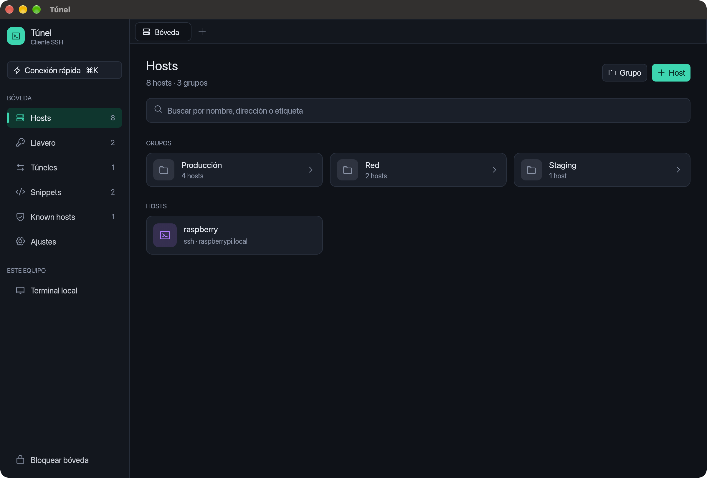

## Funciones

### Hosts y bóveda

- **Bóveda local cifrada** con contraseña maestra (Argon2id + XChaCha20-Poly1305). Nada sale del equipo.
- **Hosts y grupos anidados**: los hosts heredan usuario y puerto de su grupo. Etiquetas,
  búsqueda por nombre, dirección o etiqueta, y duplicar host.
- **Llavero**: identidades (usuario + contraseña, clave o agente SSH) y claves privadas
  OpenSSH/PEM, cifradas o no, con certificados OpenSSH opcionales.
- **Importar `~/.ssh/config`**: hosts, usuarios, puertos, `ProxyJump` y claves.
- **Conexión rápida** (`⌘K` / `Ctrl+K`): busca un host guardado o escribe
  `usuario@servidor:puerto` (también `ssh usuario@servidor -p 2222`) para conectar sin guardarlo.

<p>
  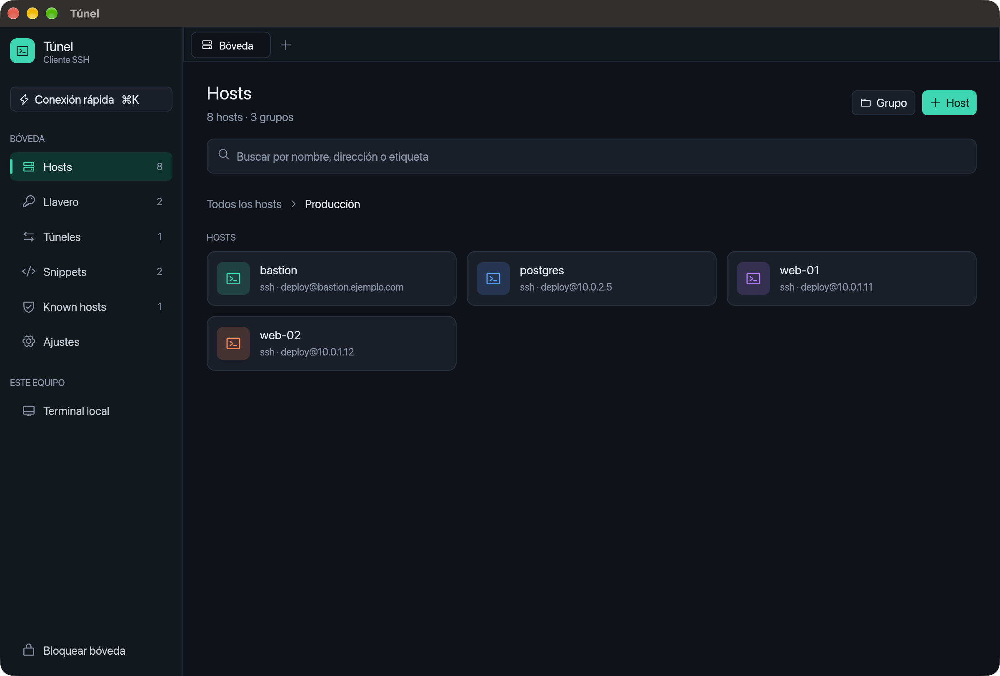
  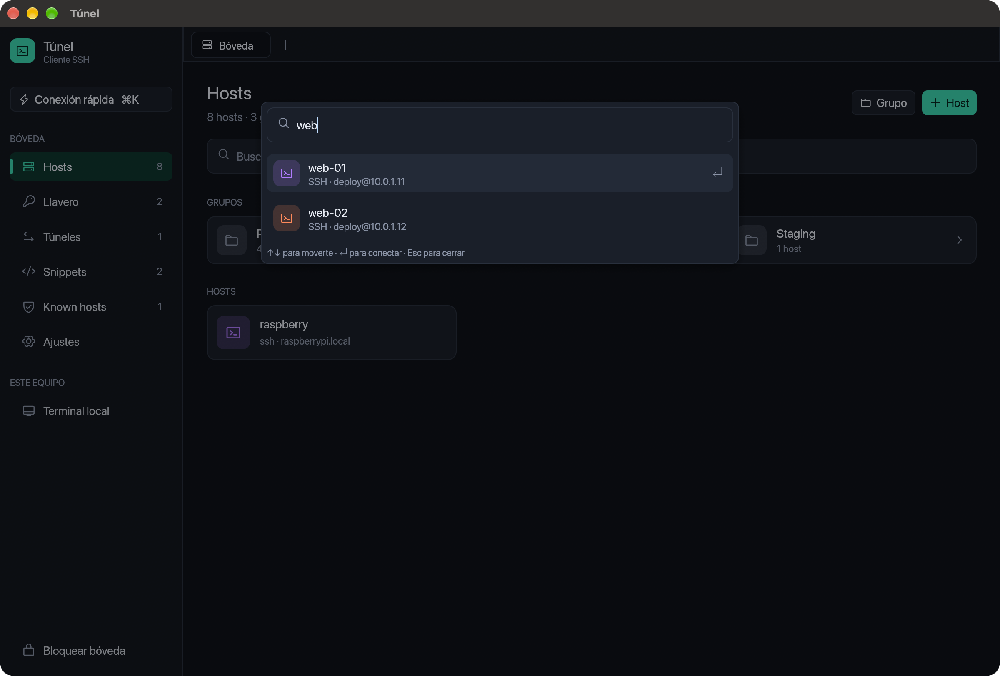
</p>

### Conexiones

- **SSH** con autenticación por clave, certificado, agente SSH (Unix y Windows), contraseña
  y keyboard-interactive (2FA).
- **Llaves de seguridad FIDO2** (claves `sk-ed25519` y `sk-ecdsa` de OpenSSH, como una YubiKey)
  en macOS y Linux: Túnel pide que toques la llave y, si la clave lo exige, el PIN.
- **Verificación de la clave del servidor**: pide confirmación la primera vez y avisa en rojo
  si la clave cambia, aunque sea de otro algoritmo.
- **Jump hosts encadenados** (ProxyJump) y conexión a través de **proxy SOCKS5 o HTTP**.
- **Mosh** (usa el `mosh-client` del sistema), **Telnet** y **puerto serie**.
- **Terminal local** del sistema.
- **Reenvío X11**: las aplicaciones gráficas del servidor se abren en tu equipo. Hace falta un
  servidor X local (XQuartz en macOS, VcXsrv en Windows; en Linux ya viene con el escritorio).
  Al servidor se le envía una cookie falsa, como hace OpenSSH, y la real no sale de tu equipo.
  Úsalo solo con servidores de confianza.
- Reenvío del agente SSH, variables de entorno y snippet de inicio por host.

<p>
  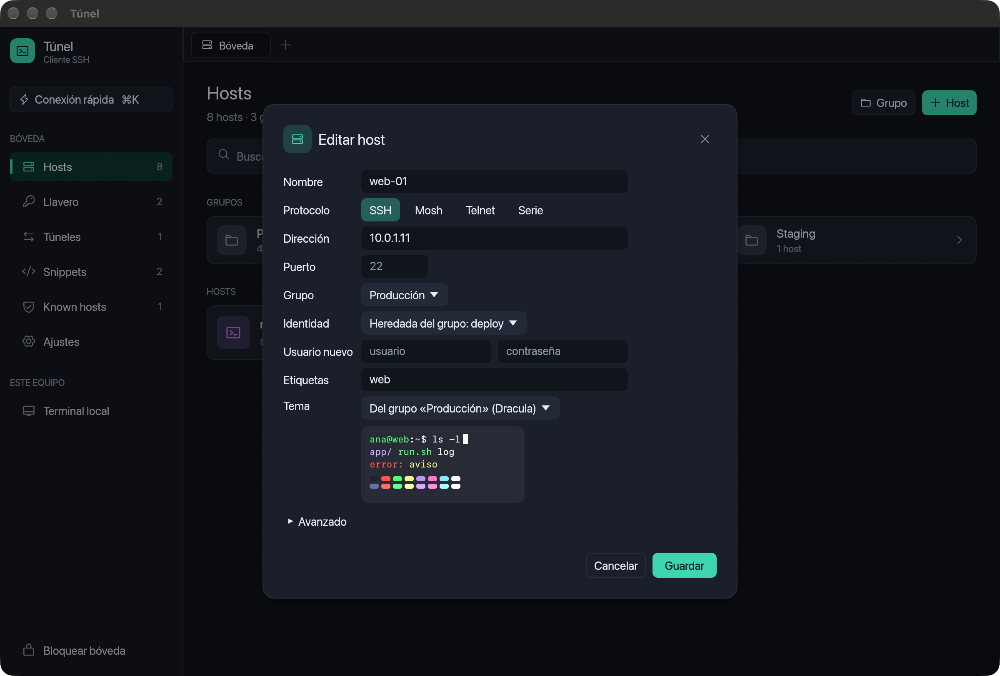
  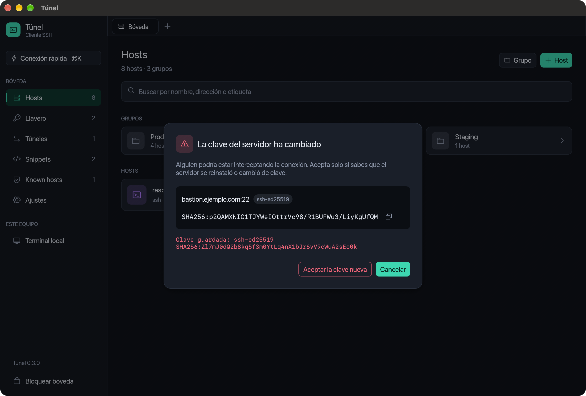
</p>

### Terminal

- Emulación basada en `alacritty_terminal`: 256 colores y truecolor, negrita, cursiva,
  subrayado, caracteres de doble ancho, historial desplazable y selección con copiar y pegar.
- Pestañas con indicador de estado, vista dividida y reconexión con un clic.
- Pegado seguro (bracketed paste), título de ventana por OSC y registro de la sesión en archivo.
- **13 temas incluidos**: Túnel Oscuro y Claro, Dracula, Nord, Tokyo Night, Catppuccin
  Mocha y Latte, One Dark, Gruvbox, Solarized Oscuro y Claro, Monokai y GitHub Claro.
- **Importa temas** de iTerm2 (`.itermcolors`) y Windows Terminal (`.json`).
- **Tema por host o por grupo**, por ejemplo uno distinto para producción. Los hosts sin tema
  propio usan el de su grupo y, si tampoco lo tiene, el general.
- Cursor en bloque, barra o subrayado. Los programas como vim pueden cambiarlo mientras se ejecutan.

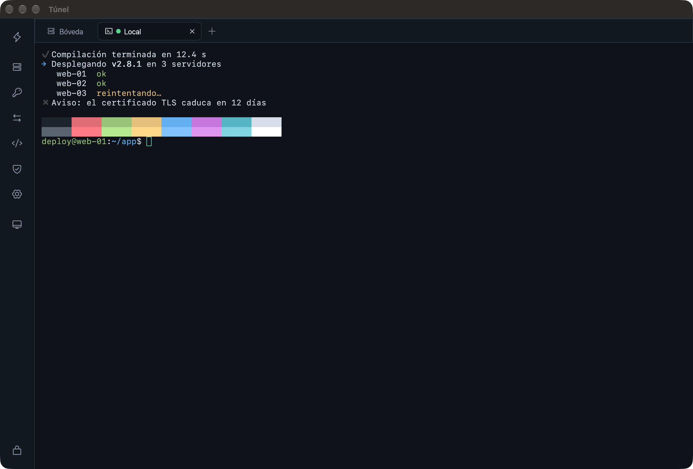

<p>
  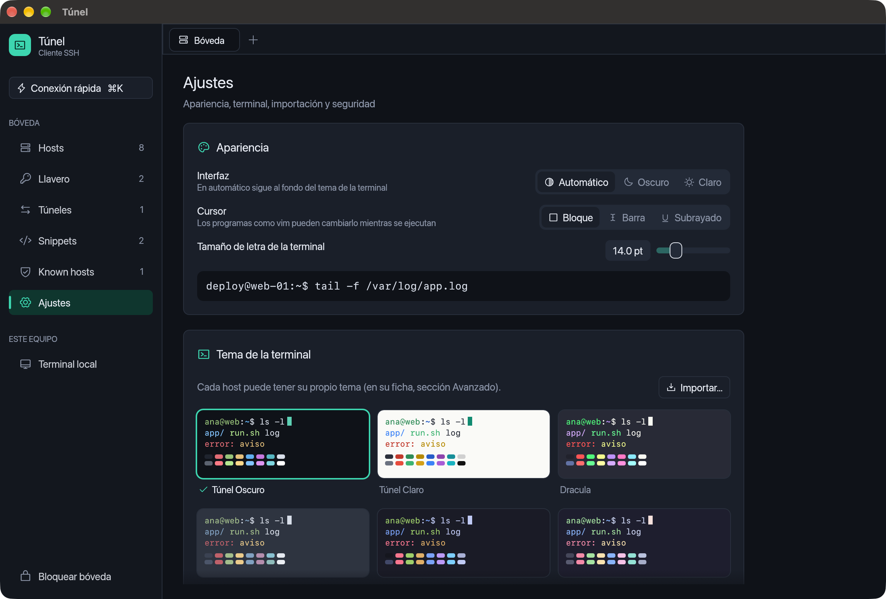
  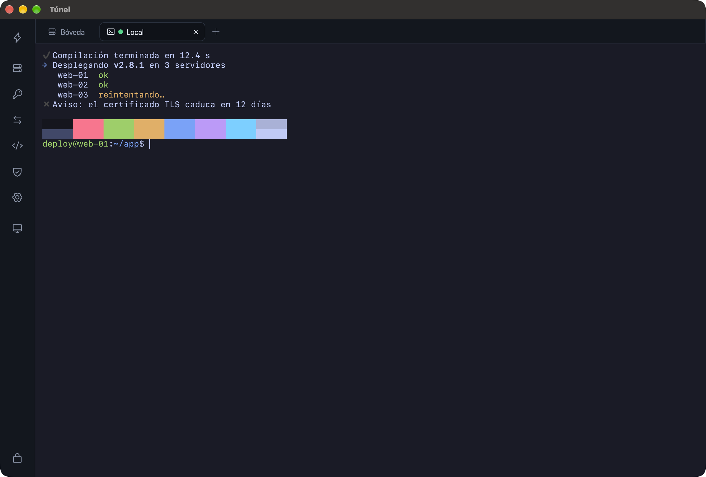
</p>

### Túneles, SFTP y snippets

- **Reenvío de puertos** local (`-L`), remoto (`-R`) y dinámico (`-D`, proxy SOCKS5), con aviso
  si una regla escucha fuera de `localhost`.
- **SFTP de doble panel**: navegar, subir, descargar, renombrar, borrar y crear carpetas.
- **Snippets**: comandos guardados que se envían a la terminal activa o a todas a la vez.

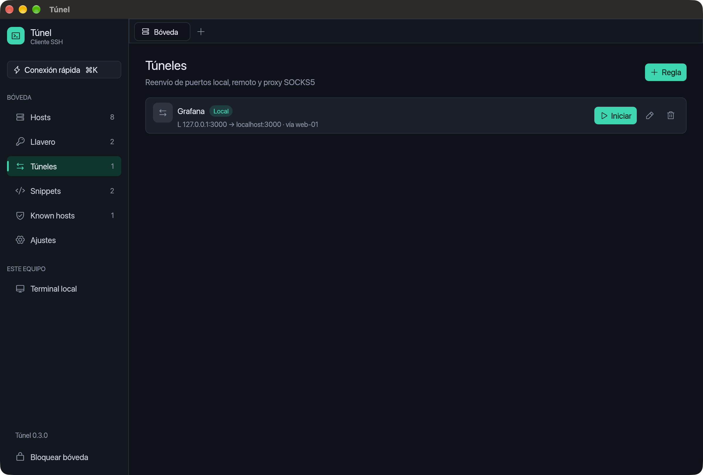

### Interfaz

- Interfaz oscura o clara; en modo automático sigue al fondo del tema de la terminal.
- Usa la fuente del sistema: SF y SF Mono en macOS, Segoe UI y Cascadia en Windows, Inter,
  Noto y JetBrains Mono en Linux si están instaladas.
- Mientras hay una sesión abierta, el menú lateral se reduce a iconos.

<p>
  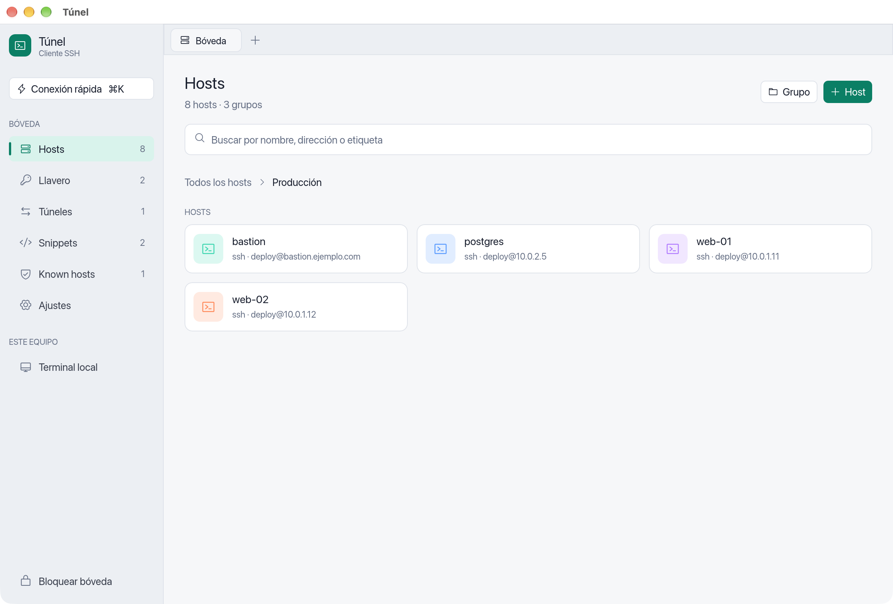
  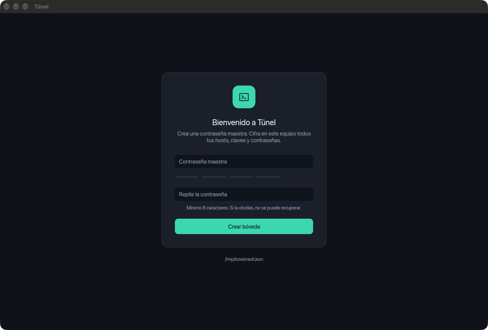
</p>

**Atajos:** `⌘K` / `Ctrl+K` conexión rápida · `⌘⇧T` / `Ctrl+Shift+T` terminal local ·
`⌘⇧W` / `Ctrl+Shift+W` cerrar pestaña.

## Instalación

Túnel muestra su versión al pie del menú lateral. Cada 12 horas pregunta a GitHub si hay
una versión nueva y, si la hay, avisa con un botón **Descargar** que abre en el navegador el
instalador de tu sistema. Un clic sobre la versión vuelve a comprobarlo. Túnel no instala nada
por su cuenta: la actualización se hace abriendo el instalador descargado.

### macOS

Descarga `tunel_<versión>_universal.dmg` desde [Releases](https://github.com/puentescamilo/Tunel/releases).
Funciona en Macs con Apple Silicon e Intel, con macOS 11 o posterior. Abre el `.dmg` y
arrastra **Túnel** a **Aplicaciones**.

La app está firmada de forma local (ad hoc) pero no notarizada por Apple, así que la primera
vez macOS la bloquea. Para abrirla:

1. Intenta abrir Túnel y cierra el aviso.
2. Ve a **Ajustes del Sistema → Privacidad y seguridad** y pulsa **Abrir igualmente** junto al
   mensaje sobre Túnel.

También puedes quitar la marca de cuarentena desde la terminal:

```bash
xattr -dr com.apple.quarantine /Applications/Túnel.app
```

Para Mosh hace falta `mosh` instalado en tu equipo y en el servidor.

### Linux

Descarga `tunel_<versión>_amd64.deb` desde [Releases](https://github.com/puentescamilo/Tunel/releases)
e instálalo con:

```bash
sudo apt install ./tunel_0.4.0_amd64.deb
```

Funciona en Ubuntu 22.04, Debian 12 o posteriores, en equipos x86_64. Para elegir archivos
(importar claves o temas) se usa el portal del escritorio (`xdg-desktop-portal`), que ya viene
en GNOME y KDE.

### Windows

Descarga uno de los dos instaladores desde [Releases](https://github.com/puentescamilo/Tunel/releases).
Ambos son para Windows 10 y 11 de 64 bits:

- `tunel_<versión>_x64-setup.exe`: se instala solo para tu usuario y no pide permisos de administrador.
- `tunel_<versión>_x64_es-ES.msi`: se instala para todo el equipo; es el indicado para
  distribuirlo en una empresa.

Los instaladores no están firmados, así que Windows SmartScreen avisa la primera vez. Pulsa
**Más información → Ejecutar de todas formas**. Túnel funciona también en equipos y máquinas
virtuales sin tarjeta gráfica: en ese caso dibuja por software.

### Desde el código

Hace falta [Rust](https://rustup.rs/) 1.89 o superior.

```bash
git clone https://github.com/puentescamilo/Tunel.git
cd Tunel
cargo run --release -p tunel-app
```

En Linux se necesitan además un compilador de C y `libudev` para el puerto serie:

```bash
sudo apt install build-essential pkg-config libudev-dev
```

La bóveda se guarda en el directorio de datos del usuario; en macOS es
`~/Library/Application Support/dev.tunel.tunel/vault.json`. Para usar otra ruta:

```bash
TUNEL_VAULT=/ruta/vault.json cargo run --release -p tunel-app
```

### Generar el `.dmg`

```bash
rustup target add aarch64-apple-darwin x86_64-apple-darwin
cargo install cargo-packager --locked
./scripts/package-macos.sh
```

El script compila para Apple Silicon e Intel, une ambos en un binario universal, lo empaqueta
con [cargo-packager](https://github.com/crabnebula-dev/cargo-packager), comprueba dentro del
`.dmg` que el ejecutable es universal y deja el resultado y su `SHA256SUMS.txt` en `dist/`.
El icono se regenera con `swift crates/tunel-app/assets/icons/generar-icono.swift icon-1024.png`.

### Generar el `.deb`

Compílalo en Ubuntu 22.04, con las dependencias de «Desde el código»: un paquete hecho en una
distribución más nueva no funciona en las anteriores.

```bash
cargo install cargo-packager --locked
cargo build --release --locked -p tunel-app
cargo packager --release -p tunel-app --formats deb
```

### Generar los instaladores de Windows

Hacen falta las Build Tools de Visual Studio 2022 con el compilador de C++. La librería de
criptografía necesita NASM, salvo que uses los objetos ya compilados que trae:

```powershell
cargo install cargo-packager --locked
$env:AWS_LC_SYS_PREBUILT_NASM = "1"
cargo build --release --locked -p tunel-app
cargo packager --release -p tunel-app --formats wix,nsis
```

cargo-packager descarga WiX y NSIS la primera vez y deja el `.msi` y el `.exe` en `dist/`.

## Sincronización entre equipos

Túnel sincroniza la bóveda entre tus equipos a través de tu propio servidor, `tunel-server`.
Más abajo se explica cómo montarlo. La bóveda local sigue siendo la principal:

- **Sin conexión:** funciona igual. Los cambios esperan en una cola cifrada hasta que el
  servidor responde.
- **Conflictos:** si editas lo mismo en dos equipos, gana la última edición.
- **Qué se sincroniza:** hosts, grupos, identidades, claves, snippets, túneles y claves de
  host conocidas. Los ajustes (fuente, tema general, cursor) son de cada equipo.

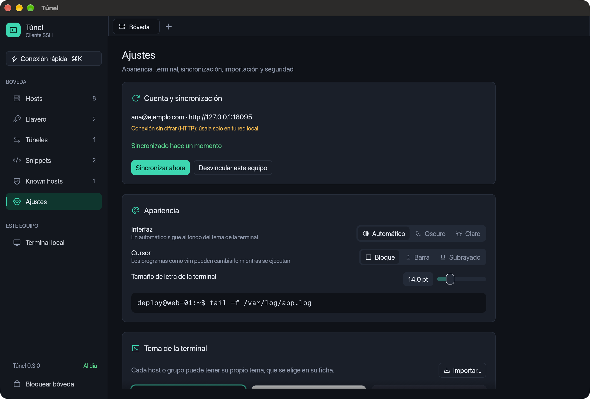

En **Ajustes → Cuenta y sincronización**, escribe la dirección del servidor, tu correo y una
contraseña para la cuenta (de al menos 12 caracteres):

- **Crear cuenta**, en el primer equipo.
- **Iniciar sesión**, en los demás. Lo que ya tuvieras en ese equipo se combina con la bóveda
  de la cuenta.

Los cambios se suben unos segundos después de hacerlos y cada equipo descarga lo nuevo cada
5 minutos, o al pulsar **Sincronizar ahora**.

La contraseña de la cuenta no sale del equipo: de ella se derivan una clave para cifrar y otra
para identificarse ante el servidor. Si la olvidas, los datos de la cuenta no se pueden
recuperar, pero la bóveda local de cada equipo sigue intacta.

## Teams: compartir hosts con otras personas

Un **Team** comparte hosts y grupos, con sus credenciales, entre varias cuentas del mismo
servidor. Va cifrado de extremo a extremo como el resto: el servidor sabe quién es miembro de
cada Team, pero no su nombre ni lo que contiene. Cada persona necesita su propia cuenta
(ver [Crear la cuenta](#4-crear-la-cuenta) para abrir el registro).

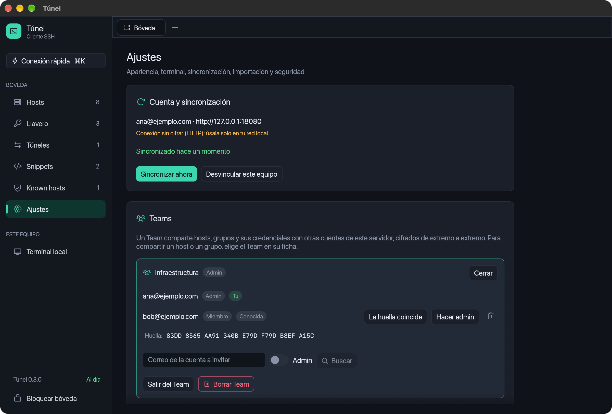

1. En **Ajustes → Teams**, escribe un nombre y pulsa **Crear Team**.
2. Pulsa **Miembros**, escribe el correo de la otra cuenta y **Buscar**. Compara con esa
   persona la **huella** que aparece (en persona o por teléfono) y, si coincide, **invita**.
3. La otra persona ve la invitación en sus Ajustes, con tu huella. Si coincide, la acepta.

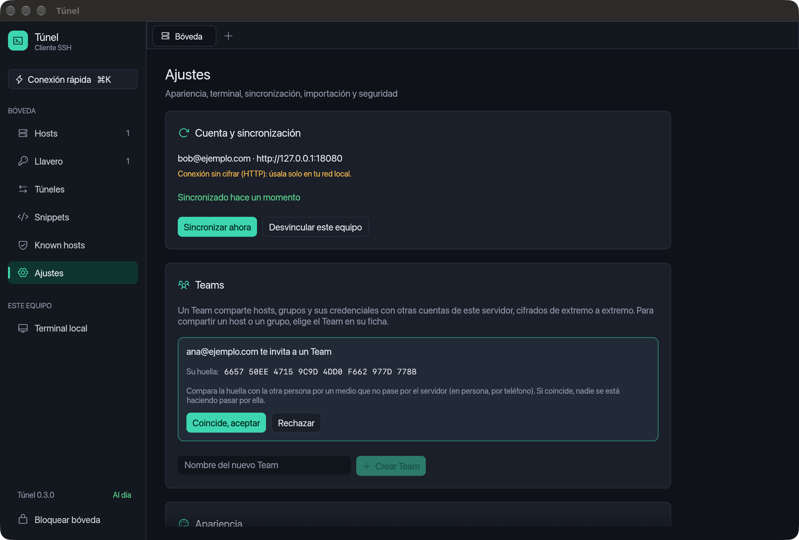

Para compartir algo, abre la ficha de un host o de un grupo y elige el Team en **Compartir
en**. Un grupo se comparte con sus subgrupos y sus hosts. Si su identidad es personal,
eliges entre llevar una copia al Team (la original no cambia) o dejarlo sin credenciales para
que cada cual ponga las suyas. Los hosts compartidos muestran el nombre del Team.

- **Roles:** los admins invitan, cambian roles, expulsan y borran el Team; los miembros usan
  y editan lo compartido.
- **Expulsar** a alguien renueva la clave del Team: deja de recibir lo que se guarde después.
  Si alguien sale por su cuenta, la clave la renueva el primer admin que sincroniza.
- **Suplantación:** Túnel recuerda la clave de cada persona la primera vez que confirmas su
  huella. Si el servidor entrega otra, el Team se detiene y lo avisa: compara la huella de
  nuevo antes de aceptarla.
- Las claves de host conocidas no se comparten: cada persona decide de qué servidores se fía.

## Montar el servidor de sincronización con Docker

`tunel-server` guarda las bóvedas cifradas de extremo a extremo: solo recibe datos cifrados
con identificadores opacos, nunca tu contraseña. Quien administre el servidor no puede leer
hosts, contraseñas ni claves. Es un único binario con una base de datos SQLite.

### Lo que necesitas

- Un equipo o máquina virtual con **Docker** y **Docker Compose 2.24 o posterior**
  (`docker compose version`). Con 512 MiB de RAM es suficiente. Sirve tanto x86_64 como ARM.
- Para usarlo fuera de tu red: un **dominio** que apunte a la IP pública del servidor y los
  puertos **80 y 443** abiertos hacia él (para el certificado de Let's Encrypt).

### 1. Descargar el código

La imagen se compila en el propio servidor, así que sirve para su arquitectura:

```bash
git clone https://github.com/puentescamilo/Tunel.git
cd Tunel
```

### 2. Arrancarlo

Elige una de estas tres formas. Todos los comandos se ejecutan desde la raíz del repositorio.
La primera vez tarda unos minutos en compilar.

**A. Con dominio y HTTPS automático (recomendada).** Caddy obtiene y renueva el certificado,
redirige HTTP a HTTPS y es lo único que queda expuesto:

```bash
echo "TUNEL_DOMINIO=tunel.tudominio.com" > crates/tunel-server/.env

docker compose -f crates/tunel-server/compose.yaml \
  -f crates/tunel-server/compose.https.yaml up -d --build
```

En Túnel, el servidor es `https://tunel.tudominio.com`.

**B. Detrás de un proxy que ya tienes** (nginx, Traefik, Caddy). El servidor escucha solo en
`127.0.0.1:8080`; apunta allí tu proxy:

```bash
docker compose -f crates/tunel-server/compose.yaml up -d --build
```

Con nginx, por ejemplo:

```nginx
server {
    listen 443 ssl;
    server_name tunel.tudominio.com;
    # ssl_certificate y ssl_certificate_key de tu certificado
    client_max_body_size 16m;
    location / {
        proxy_pass http://127.0.0.1:8080;
    }
}
```

**C. Solo en tu red local, para probar.** En `crates/tunel-server/compose.yaml`, cambia
`"127.0.0.1:8080:8080"` por `"8080:8080"` y arranca como en la opción B. En Túnel, el servidor
es `http://<IP-del-servidor>:8080`. Túnel solo acepta HTTP con direcciones de red local y avisa
de que la conexión no va cifrada; el contenido sigue cifrado de extremo a extremo, pero no lo
expongas así a Internet.

### 3. Comprobar que funciona

```bash
docker compose -f crates/tunel-server/compose.yaml ps   # debe decir (healthy)
curl https://tunel.tudominio.com/health                  # responde: ok
```

En la opción B o C, usa `curl http://127.0.0.1:8080/health` en el propio servidor.

### 4. Crear la cuenta

En el primer equipo, abre **Ajustes → Cuenta y sincronización**, escribe la dirección del
servidor, tu correo y la contraseña de la cuenta, y pulsa **Crear cuenta**. En los demás
equipos, usa los mismos datos con **Iniciar sesión**.

El servidor solo deja crear **la primera cuenta**, para que nadie más pueda usarlo. Para
admitir más (por ejemplo, una por persona o para los [Teams](#teams-compartir-hosts-con-otras-personas)),
crea `crates/tunel-server/.env` con una de estas opciones y vuelve a ejecutar el comando de
arranque:

```bash
# Solo correos de estos dominios, separados por comas. Cada persona crea su cuenta.
TUNEL_DOMINIOS_PERMITIDOS=gammaingenieros.com,otra-empresa.com

# O cualquier correo. Ábrelo solo mientras creas las cuentas y luego bórralo.
TUNEL_REGISTRO_ABIERTO=1
```

Con `TUNEL_DOMINIOS_PERMITIDOS`, el registro queda abierto solo para esos dominios, exactos
(`gammaingenieros.com` no incluye `dev.gammaingenieros.com`). Las cuentas que ya existían
siguen funcionando aunque su correo sea de otro dominio. El servidor muestra al arrancar qué
registro tiene: `docker compose -f crates/tunel-server/compose.yaml logs tunel-server`.

### Mantenimiento

En estos comandos, añade `-f crates/tunel-server/compose.https.yaml` después del primer `-f`
si usas la opción A.

- **Actualizar** a una versión nueva: `git pull` y el mismo comando de arranque. Los datos se
  conservan en el volumen `tunel-server_tunel-datos`.
- **Ver los registros:** `docker compose -f crates/tunel-server/compose.yaml logs -f tunel-server`.
- **Copia de seguridad:** para el servidor, copia la base de datos del volumen y vuelve a
  arrancarlo. Deja `tunel.db` en la carpeta actual:

  ```bash
  docker compose -f crates/tunel-server/compose.yaml stop tunel-server
  docker run --rm -v tunel-server_tunel-datos:/datos:ro -v "$PWD":/copia \
    debian:bookworm-slim cp /datos/tunel.db /copia/
  docker compose -f crates/tunel-server/compose.yaml start tunel-server
  ```

  El contenido de la copia está cifrado, pero incluye los datos de inicio de sesión de las
  cuentas: guárdala en un sitio seguro.
- **Restaurar una copia:** con el servidor parado, copia `tunel.db` de vuelta al volumen:

  ```bash
  docker compose -f crates/tunel-server/compose.yaml stop tunel-server
  docker run --rm -v tunel-server_tunel-datos:/datos -v "$PWD":/copia:ro \
    debian:bookworm-slim sh -c "cp /copia/tunel.db /datos/tunel.db && chown 10001 /datos/tunel.db"
  docker compose -f crates/tunel-server/compose.yaml start tunel-server
  ```

  Después, pulsa **Sincronizar ahora** en cada equipo. Si la copia es anterior a la última
  sincronización, Túnel avisará de que el servidor devuelve datos antiguos: es la protección
  contra un servidor que retrocede. En ese caso, desvincula el equipo y vuelve a iniciar
  sesión; su bóveda local se combinará con la de la copia.

### Configuración

| Variable | Para qué sirve | Valor en Docker |
|---|---|---|
| `TUNEL_DOMINIO` | Dominio del certificado HTTPS (solo opción A) | — |
| `TUNEL_REGISTRO_ABIERTO` | `1` permite crear más de una cuenta | sin definir |
| `TUNEL_DOMINIOS_PERMITIDOS` | Dominios de correo con los que se pueden crear cuentas, separados por comas | sin definir |
| `TUNEL_DB` | Archivo de la base de datos SQLite | `/datos/tunel.db` |
| `TUNEL_ESCUCHA` | Dirección y puerto en los que escucha | `0.0.0.0:8080` |

El [`compose.yaml`](crates/tunel-server/compose.yaml) arranca el servidor sin privilegios, con
el sistema de archivos de solo lectura y un límite de memoria. El servidor limita los intentos
de inicio de sesión por cuenta y las peticiones sin sesión, el tamaño de las peticiones y el
espacio de cada cuenta (20 000 registros y 256 MiB).

## Seguridad

- La contraseña maestra no se guarda. Si la olvidas, la bóveda no se puede recuperar.
- La bóveda se escribe de forma atómica: archivo temporal privado, `fsync` y renombrado, con
  permisos `0600` en Unix. Solo una instancia de Túnel puede abrirla a la vez.
- Los parámetros de Argon2 leídos del archivo tienen límites, para que uno manipulado no agote la memoria.
- El texto pegado se limpia de caracteres de control, así que no puede inyectar teclas.
- La contraseña guardada solo se envía cuando el servidor la pide; los códigos 2FA los escribe el usuario.
- Contraseñas, frases de paso y claves privadas no aparecen en los registros de depuración,
  y se borran de la memoria al bloquear la bóveda.

**Pendiente:**
- La interfaz hace copias temporales de la bóveda que no se borran de la memoria explícitamente.
- En Windows el archivo usa los permisos heredados de la carpeta del usuario.

## Estado y hoja de ruta

| Función | Estado |
|---|---|
| Bóveda, hosts, grupos, llavero, importar `~/.ssh/config` | ✅ |
| SSH (clave, certificado, agente, contraseña, 2FA), jump hosts, proxys | ✅ |
| Terminal, pestañas, vista dividida, temas e importación de temas | ✅ |
| Túneles local, remoto y SOCKS5 · SFTP · snippets | ✅ |
| Telnet, puerto serie, terminal local | ✅ |
| Mosh | ✅ con el `mosh-client` del sistema |
| Tema por grupo, reenvío X11 | ✅ |
| Llaves FIDO2 (`sk-*`) | ✅ macOS y Linux · ⏳ Windows |
| Cliente Mosh propio | ⏳ más adelante |
| Autocompletado de comandos, desbloqueo biométrico | ⏳ fase 2 |
| Importar de AWS, Azure, DigitalOcean, Docker y Kubernetes | ⏳ fase 3 |
| Sincronización entre equipos (servidor propio, cifrado de extremo a extremo) | ✅ |
| Teams: hosts compartidos entre cuentas | ✅ |
| Sesiones compartidas | ⏳ fase 3 |

## Desarrollo

```bash
cargo test --workspace                                  # pruebas
cargo clippy --workspace --all-targets -- -D warnings   # lint
cargo fmt --all                                         # formato
```

| Crate | Contenido |
|---|---|
| `tunel-core` | Modelos, bóveda cifrada, temas guardados, importación de `~/.ssh/config`, núcleo de la sincronización |
| `tunel-ssh` | Cliente `russh`: autenticación, claves de host, jump hosts, proxys, shell, túneles, SFTP, Mosh |
| `tunel-term` | Emulador de terminal, temas incluidos e importadores, teclado, terminal local, Telnet, serie |
| `tunel-app` | Interfaz `egui` y sistema de diseño (`src/ui`) |
| `tunel-sync` | Cliente de sincronización: cuentas y rondas de sincronización con el servidor |
| `tunel-server` | Servidor de sincronización (axum + SQLite): cuentas, sesiones y registros cifrados |

**Pruebas:** 298 en total.

- **SSH:** 16 de punta a punta contra un servidor SSH que arranca el propio test
  (`crates/tunel-ssh/tests/end_to_end.rs`). Cubren contraseña, clave cifrada, 2FA, clave de
  host nueva y cambiada, shell, túnel local, SOCKS5, jump hosts, reenvío X11 y llaves FIDO2
  (con una llave simulada). Las claves de `crates/tunel-ssh/tests/fixtures` son solo para
  esas pruebas.
- **Sincronización:**
  - las de la API del servidor (`crates/tunel-server/tests/api.rs`);
  - las de varios equipos contra un `tunel-server` real, incluido uno que intenta ocultar
    datos (`crates/tunel-sync/tests/sync.rs`).

Aún no tienen pruebas automáticas el SFTP contra un servidor real, Mosh, Telnet, el puerto
serie ni la interfaz.

**Capturas y pruebas manuales:** en compilaciones de depuración, unas variables de entorno
abren la app directamente en una pantalla con datos de ejemplo:

```bash
cargo run -p tunel-core --example demo_vault -- /tmp/demo.json demo-password
TUNEL_VAULT=/tmp/demo.json TUNEL_DEV_PASSWORD=demo-password TUNEL_DEV_SECTION=settings \
  cargo run -p tunel-app
```

Otras variables: `TUNEL_DEV_GROUP=<grupo>`, `TUNEL_DEV_LOCAL=1` (con `TUNEL_DEV_RUN=<comando>`),
`TUNEL_DEV_QUICK=<texto>`, `TUNEL_DEV_EDIT=<host>`, `TUNEL_DEV_PROMPT=cambio|nuevo|llave`,
`TUNEL_DEV_THEME=<id de tema>`, `TUNEL_DEV_CURSOR=bloque|barra|subrayado`,
`TUNEL_DEV_SCROLL=temas` (baja en Ajustes hasta los temas),
`TUNEL_DEV_TEAM=1` (despliega en Ajustes el primer Team con sus miembros),
`TUNEL_DEV_SYNC=crear|<servidor>|<correo>|<contraseña>` (o `entrar|…`, une el equipo a una
cuenta), `TUNEL_DEV_VERSION=<versión>` (simula otra versión instalada para ver el aviso de
actualización) y `TUNEL_DEV_POSITION=x,y` (posición de la ventana; en un Mac con dos pantallas
sirve para capturar en la Retina). No existen en compilaciones `--release`.

## Licencia

Túnel es software libre bajo la [GNU General Public License, versión 3](LICENSE) (solo esa
versión, `GPL-3.0-only`). Puedes usarlo, estudiarlo, modificarlo y redistribuirlo; si
distribuyes una versión modificada, debe publicarse con la misma licencia y con su código
fuente.

Copyright © 2026 Camilo Puentes.

## Créditos

- Iconos de [Phosphor Icons](https://phosphoricons.com/) (MIT), incluidos en `crates/tunel-app/assets/fonts`.
- Paletas de [Dracula](https://draculatheme.com/), [Nord](https://www.nordtheme.com/),
  [Catppuccin](https://catppuccin.com/), [Tokyo Night](https://github.com/folke/tokyonight.nvim),
  [Gruvbox](https://github.com/morhetz/gruvbox), [Solarized](https://ethanschoonover.com/solarized/),
  One Dark, Monokai y GitHub, de sus respectivos autores.
- Construido sobre [russh](https://github.com/Eugeny/russh), [alacritty_terminal](https://github.com/alacritty/alacritty)
  y [egui](https://github.com/emilk/egui).
